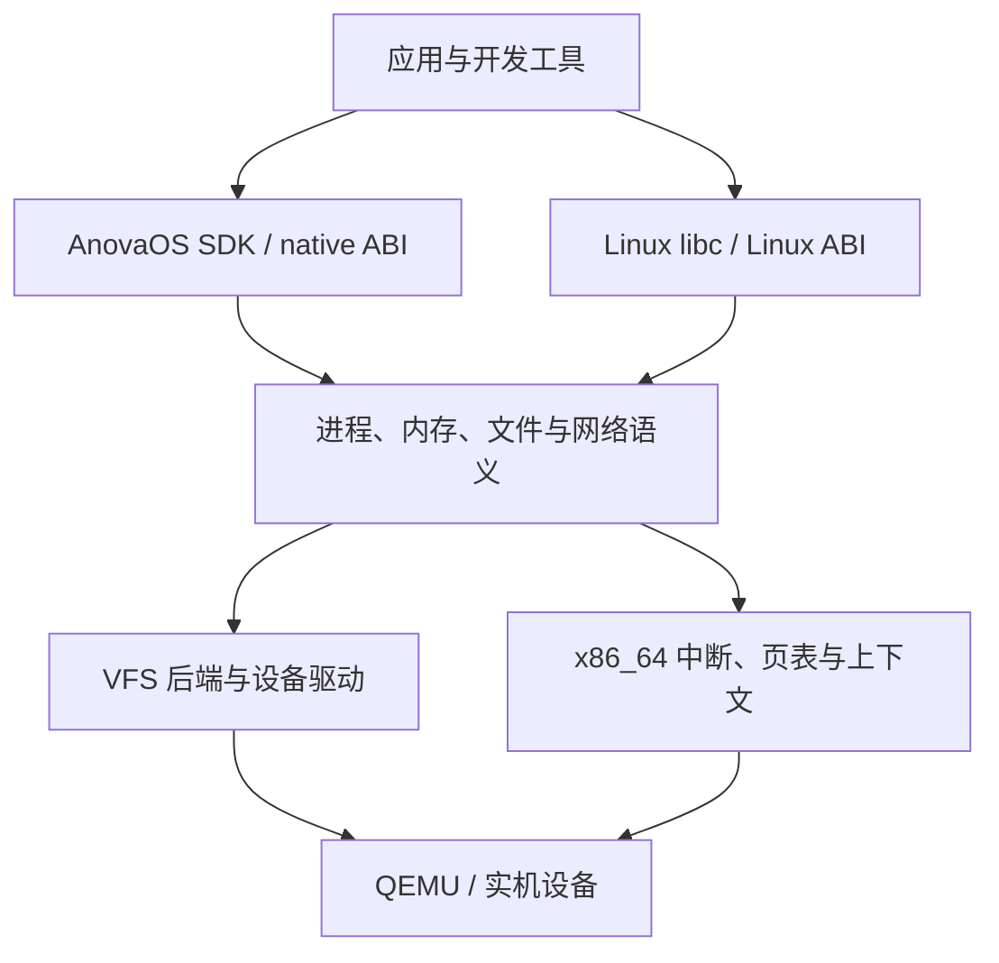

# 架构设计

本文描述目标架构；仅以下 M0/M1 启动子集已实现，其余部分仍为规划。当前能力见 [STATUS](docs/STATUS.md)。

## 1. 总体结构

采用模块化单体内核。系统服务以用户进程逐步移出内核；驱动初期运行在内核，后期再依据实际需求增加隔离。

native 和 Linux 的 ABI 分派共享内部资源模型。接口差异在适配层转换；不能各自维护互相脱节的文件/进程实现。

## 2. 启动与平台边界

UEFI 固件启动 Limine；Limine 装载内核 ELF 和 initramfs，并按锁定协议传递内存图、RSDP、HHDM 与 framebuffer 等响应。内核立即建立清楚的数据所有权与初始化次序。

早期序列：串口尽力日志 → 校验启动响应 → 固定必需信息与保留区域 → CPU 异常基础 → 页管理/堆 → ACPI/APIC/时钟 → 任务/VFS → init。

引导器可能已建立页表，接管前不能假定所有映射都由自己拥有。UEFI Boot Services 退出后的可用接口受固件约束；正常内核运行不依赖已经结束的固件服务。Rust 的 UEFI target 用于 UEFI 程序，内核使用独立裸机 target。

最初平台：q35、OVMF、COM1、现代 virtio PCI block/net/rng。设备按阶段加入；M1 不依赖 virtio。PS/2 可用于模拟器早期输入，不能据此宣称支持实机 USB 键盘。

### 当前 M1 实现

- `kernel/src/boot.rs` 使用 Limine 9.5.0 + `limine = 0.5.0`，显式请求并校验 base revision 3、UEFI64、4 级分页、HHDM、内存图和内核基址；请求由 linker `KEEP` 保留在可写专用段。
- `kernel/src/serial.rs` 以 115200/8N1 输出 COM1；单 BSP、IRQ 关闭，没有日志锁或分配。panic 独立构造 writer，UART 轮询有次数上限。
- 所有响应和 memory map 在整个 M1 生命周期内借用，全部内存保留。尚无 allocator，不回收 bootloader-reclaimable 区域，不接管引导器栈或页表；M3 必须先建立显式所有权才能回收。
- base revision 3 的 RSDP 是物理地址，M1 只检查非零/范围溢出并报告，ACPI 表映射和校验留给 M2；UEFI 地址不要求 legacy 扫描用的 16 字节对齐。framebuffer 只检查元数据，不写显存，缺失时降级；不加载 initramfs。
- `xtask` 使用宿主 `std`；内核使用独立裸机目标和 linker script。镜像为 UEFI El Torito ISO，仅由固定路径的普通文件生成。默认 q35/TCG、256 MiB、1 vCPU，无网卡和数据盘；变量固件从校验过的模板复制到 `build/tmp/`，代码固件只读。
- 普通镜像输出 `[BOOT:OK]` 后 `cli; hlt`。测试特性才访问 QEMU `isa-debug-exit`：成功写 `0x10`（宿主 33），panic 写 `0x11`（宿主 35）；测试器同时验证阶段顺序、最终标记和退出状态，并对挂起执行 kill/wait。

## 3. 目录规划

以下是后续实现布局，不要求一次性创建：

| 路径 | 职责 |
| --- | --- |
| `kernel/src/arch/x86_64/` | GDT/IDT/TSS、trap、syscall 入口、APIC、页表和上下文 |
| `kernel/src/boot/` | Limine 响应校验、引导数据所有权、初始化顺序 |
| `kernel/src/mm/` | frame allocator、VMA、地址空间、堆、用户内存访问 |
| `kernel/src/task/` | 进程/线程、调度、信号、等待和执行生命周期 |
| `kernel/src/fs/` | VFS、文件描述符、tmpfs、initramfs、devfs、ext2 |
| `kernel/src/ipc/` | 管道、事件等待、后续共享内存与本地 socket |
| `kernel/src/drivers/` | PCI、virtio、串口、时钟和后续硬件驱动 |
| `kernel/src/net/` | 网络设备集成、协议栈、socket 内部语义 |
| `kernel/src/abi/native/` | 有版本的自有 ABI、native syscall/扩展 |
| `kernel/src/abi/linux/` | Linux 编号/errno/结构体/flags/信号帧转换 |
| `crates/abi/` | SDK 与内核共享的、可明确序列化/布局的 ABI 定义 |
| `crates/elf/` | 无硬件依赖的受限 ELF 校验和解析 |
| `crates/platform/` | 仅在有实际复用时抽出的平台接口 |
| `user/rt/`、`user/sdk/` | native CRT、syscall 包装与应用库 |
| `user/init/`、`user/shell/` | 系统初始化、最小 shell 与自有工具 |
| `user/examples/` | Rust/C/C++ 应用及预期结果 |
| `xtask/` | 宿主构建、镜像、运行、测试和诊断 |
| `boot/`、`linker/` | 固定协议的配置、内核/用户链接脚本 |
| `ports/`、`sysroot/` | 第三方配方/补丁与生成的用户态环境规则 |
| `tests/host/`、`tests/guest/`、`tests/compat/` | 纯逻辑、系统内与软件兼容验证 |
| `docs/`、`docs/adr/` | 设计、证据和重要决定 |

`target/`、生成的 sysroot 内容、工具链下载和磁盘镜像不提交 git；只提交配方、锁定清单、补丁和小型自有测试源码。

## 4. 内存与权限

先采用 4 KiB 页、4 级分页、高半内核映射和独立用户地址空间。具体虚拟地址区间在实现页表时记录，避免在多个文件里复制魔数。

- `PhysAddr`、`VirtAddr`、`UserAddr` 等类型避免混用；设备映射记录缓存属性。
- 页帧保留表覆盖内核、模块、framebuffer、固件/ACPI、栈和页表。
- HHDM 只提供受控物理访问途径，不等于任意物理地址可读写。
- 用户映射带 U/S、R/W、NX 权限，加载器落实 W^X，栈带 guard page。
- 用户内存复制处理跨页和故障；内核不直接信任用户传入的结构体或嵌套指针。
- 初版 `fork` 可以复制地址空间，正确后再实现 COW；先测生命周期，再优化性能。

## 5. 进程、线程与系统调用

进程拥有地址空间、文件表、cwd、身份、信号处置和 ABI personality；线程拥有寄存器、内核栈、用户栈、TLS、调度状态和信号屏蔽。

系统调用入口负责：安全切换栈/状态 → 保存上下文 → 按进程 personality 分派 → 验证用户内存 → 调用公共服务 → 按 ABI 编码结果 → 验证返回状态。

x86_64 `SYSCALL` 不会自动切换到内核栈。入口设计必须考虑每线程栈、GS 基址、嵌套异常、RCX/R11、返回地址合法性与 RFLAGS；不能把一段寄存器转发汇编当成完整隔离实现。复杂返回先使用可验证的安全路径，再优化。

native ABI 使用自己编号和版本；Linux 进程遵循 Linux x86_64 ABI。选择 personality 采用打包清单/exec 配置等显式机制，ELF OSABI 只用于辅助校验。后续具体 syscall 表单独建档。

单核先实现可阻塞等待队列与抢占；再加入线程与 futex；SMP 在锁、per-CPU 数据、TLB shootdown 和中断路由成熟后开启。

## 6. 文件、存储与终端

统一 VFS 处理 inode/目录、打开文件描述、fd 表、权限和挂载。`dup` 与 `fork` 后的 fd 要正确共享打开文件偏移；只复制整数不足以表达其语义。

阶段顺序：initramfs 只读根 → tmpfs 与 devfs → virtio-blk → 支持明确特性集合的 ext2。FAT/ESP 作为引导分区，不承担工具链工作目录。

第一版 ext2 可以限制不支持的特性；遇到未知特性要拒绝挂载。实现块边界、间接块、元数据更新、flush/fsync 和受控关机验证；无日志文件系统不能宣称任意断电后无损。

TTY 包含输入行规程、回显、termios、信号与窗口大小。串口控制台与 PTY 共用合理的终端语义；编辑器、shell 作业控制和构建工具的终端需求按阶段落实。

## 7. ELF、运行时与动态链接

第一步仅装载受限 ELF64 ET_EXEC：校验机器类型、长度和溢出，校验 PT_LOAD 地址、权限和段重叠，清零 BSS，建立栈/参数/环境，跳转 Ring 3。

随后增加 Linux 要求的 auxv、TLS、静态 PIE。对 `PT_INTERP`，内核装载指定动态解释器并准备正确入口信息；musl/glibc 动态链接器在用户态处理通常的共享库装载、符号解析与重定位。内核需要提供 mmap/mprotect、文件访问、TLS 等语义，不自行重写整个 ELF 动态链接器。

没有 vDSO 时，只能在所选用户态确实支持 syscall 回退的情况下省略对应 auxv 项；不能提供假地址或伪造支持。

## 8. SDK 与开发环境

native SDK 从 M4 的 `no_std` 应用与最小 runtime 开始。开发者可先用受测 Linux-musl target 编写带 `std` 的应用；AnovaOS 专用 target、libc/`std` 端口和扩展服务在后期独立完善。

应用开发链涉及三种不同输出：内核 ELF、native 用户 ELF、Linux 兼容 ELF。构建元数据必须记录 ABI/编译器/sysroot，避免同名文件混装。

系统软件包安装在约定根目录；编译器有独立 sysroot；`/tmp`、`/dev`、必要的 `/proc` 接口和动态解释器路径按实测需要提供。包内容和内核不是同一种发布单元。
