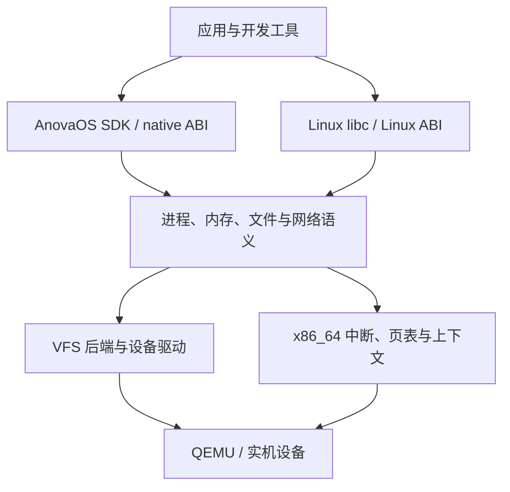

<!-- Describe implemented subsystem boundaries and the planned operating-system architecture. -->
# 架构设计

本文描述目标架构与已实现的 M0–M10 子集：启动、BSP 异常/时钟、内存、隔离用户应用、单核进程/线程、VFS/持久存储和受限 Linux 运行时。现已增加受控 IPv4 网络与包管理；系统内编译器、SMP 与图形部分仍为规划。当前能力见 [STATUS](docs/STATUS.md)。

## 1. 总体结构

采用模块化单体内核。系统服务以用户进程逐步移出内核；驱动初期运行在内核，后期再依据实际需求增加隔离。



native 和 Linux 的 ABI 分派共享内部资源模型。接口差异在适配层转换；不能各自维护互相脱节的文件/进程实现。

## 2. 启动与平台边界

UEFI 固件启动 Limine；Limine 装载内核 ELF 和 initramfs，并按锁定协议传递内存图、RSDP、HHDM 与 framebuffer 等响应。内核立即建立清楚的数据所有权与初始化次序。

早期序列：串口尽力日志 → 校验启动响应 → 固定必需信息与保留区域 → 受限早期映射与 CPU 异常基础 → ACPI/APIC/时钟 → M3 页管理/堆 → 任务/VFS → init。

引导器可能已建立页表，接管前不能假定所有映射都由自己拥有。UEFI Boot Services 退出后的可用接口受固件约束；正常内核运行不依赖已经结束的固件服务。Rust 的 UEFI target 用于 UEFI 程序，内核使用独立裸机 target。

最初平台：q35、OVMF、COM1、现代 virtio PCI block/net/rng。设备按阶段加入；M1 不依赖 virtio。PS/2 可用于模拟器早期输入，不能据此宣称支持实机 USB 键盘。

### Current boot and M2 BSP implementation

- Limine 9.5.0 + `limine = 0.5.0` validate base revision 3, UEFI64, four-level
  paging, HHDM, the memory map and kernel reservation. Writable requests remain
  protected by linker `KEEP`. Boot responses and all original memory stay live.
- `arch/x86_64/` installs GDT/TSS/256 IDT gates through stable assembly entries.
  Three static 16 KiB IST stacks have removed 4 KiB guard mappings. Breakpoints
  return through `iretq`; fatal exceptions report the full GPR frame, CR2 and
  decoded #PF/#GP error fields. A real stack failure reaches #DF on IST1.
- A bounded 32-page pool clones the active root and only the modified table
  paths. It preserves all other Limine mappings. Guard pages and explicit
  read-only NX ACPI / UC NX APIC windows do not require a frame allocator.
  This remains the early-boot boundary; M3 subsequently clones every live table
  into checked frame storage before switching to the owned hierarchy.
- The shared `anova-platform` crate decodes bounded ACPI bytes with checksum and
  length checks. Required tables are RSDP, XSDT/RSDT, MADT and FADT. The APIC CPU
  feature, MSR base, MADT identity, NX and PAT assumptions are checked.
- Both PICs and every discovered I/O APIC redirection remain masked. Only local
  APIC vector 64 is enabled; spurious vector 255 returns without EOI. A 20 ms
  ACPI PM-counter sample calibrates the 100 Hz periodic timer. Its handler
  increments an atomic count, sends one EOI, and never logs or allocates.
- COM1 output preserves IF while serializing normal BSP calls. Panic and fatal
  exception paths use independent bounded, lock-free emergency output. There is
  no AP startup; M5 adds the BSP scheduler below. Normal idle uses `sti; hlt` after timer validation.
- `xtask` still builds a UEFI El Torito ISO for q35/TCG, 256 MiB and one CPU, with
  disposable firmware variables and no network. M7 now attaches a temporary
  data disk by default, with explicit persistent images described below. Smoke passes only
  with ordered CPU/timer markers, 8+ IRQs, returning breakpoints and exit 33.
  Panic exits 35 and real exceptions exit 37; all are failures. The gate checks
  that each negative case reached its expected injection and diagnosis.

See [M2 CPU details](docs/M2_CPU.md) for exact bounds, contexts and limitations,
[M0/M1 evidence](docs/validation/M0-M1.md) for the historical boot gate, and
[M2 evidence](docs/validation/M2.md) for the historical M2 validation.

### Current M3 memory implementation

- `anova-memory` shares checked usable-frame allocation, buddy-heap policies and
  four-level page-table algorithms with host tests. State metadata has an explicit
  page-rounded reservation; bootloader memory and all non-USABLE ranges stay reserved.
- Every active table is cloned into owned frames. New paths roll back on OOM;
  empty tables are unlinked, locally flushed and reclaimed. Dynamic edits use
  4 KiB leaves; imported huge leaves retain backing and cache attributes.
- NX covers HHDM aliases and new data mappings; CR0.WP is enabled. A new 64 KiB
  execution stack has two absent guards and owns RSP0. A 2 MiB buddy heap enables
  stable Rust `alloc`, fallible OOM and a terminal allocation error diagnostic.
- Test-only pressure validation covers complete frame exhaustion, map rollback,
  reuse, container lifetimes and coalescing. The full gate has 13 independent
  images, including real read-only/NX/guard/unmap faults and infallible heap OOM.

See [M3 memory design](docs/M3_MEMORY.md) and [M3 evidence](docs/validation/M3.md).
M4 adds private user roots as described below; M7 adds an owned DMA frame for virtio-blk; SMP shootdown and boot-memory reclamation remain pending.

### Current M4 native user implementation

- `crates/elf` validates bounded static ET_EXEC input before allocation; `crates/abi`
  defines native v1 numbers, errors, checked user ranges and a 32-byte query layout.
- Each sequential invocation owns private lower tables, zeroed user pages and a
  guarded 64 KiB kernel stack, borrowing only supervisor kernel upper paths.
- SYSCALL switches immediately to the trusted stack, then returns through a
  validated IRETQ frame. User copying checks every page and recovers only the
  guarded assembly copy instruction. Synchronous user faults end one app.
- x87/SSE2 are initialized per invocation. The kernel remains SIMD-free; M5 must
  add saved extended-state contexts before task switching.
- Separate Rust/C user builds produce actual ELF modules with explicit ABI/hash
  inventory. Both hello apps, 11 isolation cases, two real copy fixups, partial
  OOM rollback and repeated teardown are accepted on q35/TCG.

See [M4 design](docs/M4_USERSPACE.md), [M4 evidence](docs/validation/M4.md),
[per-file inventory](docs/FILE_PURPOSES.md) and [DEV-001](docs/REQUIREMENTS.md).

### Current M5 process implementation

- `anova-sched` supplies bounded state transitions, parent/wait semantics, console
  descriptor ownership and round-robin policy shared with host tests.
- Each of 32 process slots owns one thread/context, private user root/pages and
  a unique 64 KiB guarded kernel stack. Trap capture returns to a separate BSP
  scheduler continuation; no Rust stack or lock is suspended across scheduling.
- User-mode timer IRQs save GPRs, segment selectors/bases and complete enabled
  x87/MMX/SSE2 state, EOI, then rotate. Kernel sections keep IF=0; idle atomically
  enables IRQs and halts. Address-space copying is pinned by these BSP ownership rules.
- Native v1 extends to spawn/exec/eager fork, sleep/yield, wait and close. Images
  come from explicit native modules; console descriptors precede M6 VFS objects.
- Exit/fault destroys inactive pages/stacks and descriptors; zombies retain only
  status until parent wait or kernel orphan reaping. Exec publishes only a fully
  loaded replacement. Partial OOM and repeated lifecycle tests require exact
  frame and heap restoration.

See [M5 design](docs/M5_PROCESSES.md) and [M5 evidence](docs/validation/M5.md).
The M4 section above records the earlier sequential baseline, superseded by M5.

### Current M6 filesystem and shell implementation

- `anova-vfs` owns boot-only initramfs/tmpfs/devfs mounts, component-wise paths,
  cwd identities, bounded nodes and shared reference-counted open descriptions.
  Independent opens have independent offsets; dup/fork/spawn share offsets and
  exec preserves descriptors/cwd. Unlink retains open data until its final close.
- Native read/open/seek/dup2/pipe/readdir/mkdir/chdir/getcwd/unlink use checked
  user copying. Blocking I/O stores only a syscall frame, drops all active user
  borrows and wakes through bounded scheduler readiness scanning at IF=0.
- One KiB pipes handle partial writes, buffer wrap, final-close EOF and broken
  readers. The console receives canonical edited lines by bounded BSP UART
  polling; LAPIC ticks wake input without external IRQ routing.
- The host packs a checked, hashed project-owned read-only archive. Native PID 1
  supervises an interactive shell; small native commands use real fork/exec/wait,
  up to four pipeline stages and file redirection. All tmpfs state is volatile.

See [M6 design](docs/M6_FILESYSTEM.md) and [M6 evidence](docs/validation/M6.md).
A general mount API, POSIX terminals and Linux binaries remain later work;
these commands are project-owned native applications. M7 adds storage below.

### Current M7 storage and editing implementation

`kernel/drivers` enumerates PCI, maps bounded modern virtio capabilities UC/NX
and owns one coherent DMA32 frame until confirmed reset. Completion is polled
with PM-timer deadlines; external IRQ routing remains disabled. `anova-storage`
shares checked sector I/O and a strict one-group, 4 KiB ext2 implementation
with host tests. VFS mounts disk metadata at `/persist` and reads file data on
demand, retaining existing descriptor/offset/process ownership. An explicit
`.anova-abi` image manifest selects native v1 for executable disk files.

Ordered writes, a dirty-superblock protocol, actual FLUSH, sync/fsync and
clean unmount precede DMA teardown and restricted QEMU ACPI S5. The native
line editor and cp/install commands save source and app files; host tooling
separates temporary disks from explicit persistent images. See
[M7 design](docs/M7_STORAGE.md) and [M7 evidence](docs/validation/M7.md).
There is no journal, atomic rename/save, crash recovery, asynchronous block
layer, hotplug, SMP or guest compiler yet.

## 3. 目录规划

以下是后续实现布局，不要求一次性创建：

| 路径 | 职责 |
| --- | --- |
| `kernel/src/arch/x86_64/` | GDT/IDT/TSS、trap、syscall 入口、APIC、页表和上下文 |
| `kernel/src/boot/` | Limine 响应校验、引导数据所有权、初始化顺序 |
| `kernel/src/mm/` | frame allocator、VMA、地址空间、堆、用户内存访问 |
| `kernel/src/task/` | 进程/线程、调度、信号、等待和执行生命周期 |
| `kernel/src/fs/` | VFS、文件描述符、tmpfs、initramfs、devfs、ext2 |
| `kernel/src/ipc/` | 管道、事件等待、后续共享内存与本地 socket |
| `kernel/src/drivers/` | PCI、virtio、串口、时钟和后续硬件驱动 |
| `kernel/src/net/` | 网络设备集成、协议栈、socket 内部语义 |
| `kernel/src/abi/native/` | 有版本的自有 ABI、native syscall/扩展 |
| `kernel/src/abi/linux/` | Linux 编号/errno/结构体/flags/信号帧转换 |
| `crates/abi/` | SDK 与内核共享的、可明确序列化/布局的 ABI 定义 |
| `crates/elf/` | 无硬件依赖的受限 ELF 校验和解析 |
| `crates/platform/` | 仅在有实际复用时抽出的平台接口 |
| `user/rt/`、`user/sdk/` | native CRT、syscall 包装与应用库 |
| `user/init/`、`user/shell/` | 系统初始化、最小 shell 与自有工具 |
| `user/examples/` | Rust/C/C++ 应用及预期结果 |
| `xtask/` | 宿主构建、镜像、运行、测试和诊断 |
| `boot/`、`linker/` | 固定协议的配置、内核/用户链接脚本 |
| `ports/`、`sysroot/` | 第三方配方/补丁与生成的用户态环境规则 |
| `tests/host/`、`tests/guest/`、`tests/compat/` | 纯逻辑、系统内与软件兼容验证 |
| `docs/`、`docs/adr/` | 设计、证据和重要决定 |

`target/`、生成的 sysroot 内容、工具链下载和磁盘镜像不提交 git；只提交配方、锁定清单、补丁和小型自有测试源码。

## 4. 内存与权限

先采用 4 KiB 页、4 级分页、高半内核映射和独立用户地址空间。具体虚拟地址区间在实现页表时记录，避免在多个文件里复制魔数。

- `PhysAddr`、`VirtAddr`、`UserAddr` 等类型避免混用；设备映射记录缓存属性。
- 页帧保留表覆盖内核、模块、framebuffer、固件/ACPI、栈和页表。
- HHDM 只提供受控物理访问途径，不等于任意物理地址可读写。
- 用户映射带 U/S、R/W、NX 权限，加载器落实 W^X，栈带 guard page。
- 用户内存复制处理跨页和故障；内核不直接信任用户传入的结构体或嵌套指针。
- 初版 `fork` 可以复制地址空间，正确后再实现 COW；先测生命周期，再优化性能。

## 5. 进程、线程与系统调用

进程拥有地址空间、文件表、cwd、身份、信号处置和 ABI personality；线程拥有寄存器、内核栈、用户栈、TLS、调度状态和信号屏蔽。

系统调用入口负责：安全切换栈/状态 → 保存上下文 → 按进程 personality 分派 → 验证用户内存 → 调用公共服务 → 按 ABI 编码结果 → 验证返回状态。

x86_64 `SYSCALL` 不会自动切换到内核栈。入口设计必须考虑每线程栈、GS 基址、嵌套异常、RCX/R11、返回地址合法性与 RFLAGS；不能把一段寄存器转发汇编当成完整隔离实现。复杂返回先使用可验证的安全路径，再优化。

native ABI 使用自己编号和版本；Linux 进程遵循 Linux x86_64 ABI。选择 personality 采用打包清单/exec 配置等显式机制，ELF OSABI 只用于辅助校验。后续具体 syscall 表单独建档。

单核先实现可阻塞等待队列与抢占；再加入线程与 futex；SMP 在锁、per-CPU 数据、TLB shootdown 和中断路由成熟后开启。

## 6. 文件、存储与终端

统一 VFS 处理 inode/目录、打开文件描述、fd 表、权限和挂载。`dup` 与 `fork` 后的 fd 要正确共享打开文件偏移；只复制整数不足以表达其语义。

阶段顺序：initramfs 只读根 → tmpfs 与 devfs → virtio-blk → 支持明确特性集合的 ext2。FAT/ESP 作为引导分区，不承担工具链工作目录。

第一版 ext2 可以限制不支持的特性；遇到未知特性要拒绝挂载。实现块边界、间接块、元数据更新、flush/fsync 和受控关机验证；无日志文件系统不能宣称任意断电后无损。

TTY 包含输入行规程、回显、termios、信号与窗口大小。串口控制台与 PTY 共用合理的终端语义；编辑器、shell 作业控制和构建工具的终端需求按阶段落实。

## 7. ELF、运行时与动态链接

第一步仅装载受限 ELF64 ET_EXEC：校验机器类型、长度和溢出，校验 PT_LOAD 地址、权限和段重叠，清零 BSS，建立栈/参数/环境，跳转 Ring 3。

随后增加 Linux 要求的 auxv、TLS、静态 PIE。对 `PT_INTERP`，内核装载指定动态解释器并准备正确入口信息；musl/glibc 动态链接器在用户态处理通常的共享库装载、符号解析与重定位。内核需要提供 mmap/mprotect、文件访问、TLS 等语义，不自行重写整个 ELF 动态链接器。

没有 vDSO 时，只能在所选用户态确实支持 syscall 回退的情况下省略对应 auxv 项；不能提供假地址或伪造支持。

## 8. SDK 与开发环境

native SDK 从 M4 的 `no_std` 应用与最小 runtime 开始。开发者可先用受测 Linux-musl target 编写带 `std` 的应用；AnovaOS 专用 target、libc/`std` 端口和扩展服务在后期独立完善。

应用开发链涉及三种不同输出：内核 ELF、native 用户 ELF、Linux 兼容 ELF。构建元数据必须记录 ABI/编译器/sysroot，避免同名文件混装。

系统软件包安装在约定根目录；编译器有独立 sysroot；`/tmp`、`/dev`、必要的 `/proc` 接口和动态解释器路径按实测需要提供。包内容和内核不是同一种发布单元。

## 9. M14 display/input and planned graphical userland/SDK architecture

The optional **M14.1 software display and M14.2 polled PS/2 input/cursor are
implemented and locally verified**. The M14.3 isolated user-space compositor
and the M14.4 GUI runtime/SDK are locally accepted. M14.5 now verifies a bounded
hardware offscreen clear/readback path with CPU fallback; ordinary desktop
composition remains software-rendered. The authoritative design and the
independently gated M14.1–M14.5 stages are in
[M14_GUI](docs/M14_GUI.md), with stage status in [ROADMAP](ROADMAP.md)
and [STATUS](docs/STATUS.md).

AnovaOS will develop its GUI engine in Rust and expose equivalent **Rust,
C++, and C application SDKs**. A Rust GUI runtime supplies rendering, text,
layout, widgets and events. Its stable inter-language FFI is a **versioned
C ABI implemented in Rust** (C headers; C++ move-safe RAII; safe Rust crate),
not a direct wrapper around privileged kernel calls. All language clients
use a single documented semantic contract; the Rust SDK may optimize its
internal call path without changing observable behavior.

```text
Rust app / C++ app / C app
     |       |       |
Rust SDK / C++ SDK / C SDK
            |
   Rust GUI runtime + C ABI
            |
   versioned IPC / shared surfaces
            |
   Rust compositor (user process)
       |            |
  CPU renderer   optional GPU renderer
       \           /
kernel IPC, mappings, display and input drivers
            |
       QEMU / hardware
```

The kernel retains buffer/memory permissions, IPC isolation, display and input
device access; windows, focus, text rendering, widgets and the desktop shell
belong to user-space components. The kernel authenticates process identities;
the compositor validates window ownership and owns presentation, stacking,
input routing, buffer lifetime and quotas.
Clients do not receive unrestricted framebuffer mappings. All display
formats/strides, damage regions, memory lengths, object handles, concurrency,
events and crash/restart paths must be bounded, versioned and verified.

GUI ABI rules: `extern "C"` exports; `#[repr(C)]` and explicit-width fields;
no Rust-owned collection layouts, implicit shared allocators or unwinding
across FFI; opaque handles and precise release ownership; explicit errors
and version/capability checks; documented thread/callback semantics. Keep
the native syscall ABI, GUI library ABI and Linux compatibility personality
distinct. Build and execute independently validated Rust, C and C++ GUI apps,
with incompatible-version and malformed-input tests.

M14.1 establishes validated framebuffer + software drawing. M14.2 delivers
bounded physical keyboard/pointer events to a diagnostic consumer and clips a cursor. M14.3 introduces an isolated user-space
compositor and two-window behavior. M14.4 adds GUI runtime, graphical terminal,
C/C++/Rust SDKs and separately tested demo applications. M14.5 optionally
adds actual GPU-accelerated rendering with software fallback. A bootloader
framebuffer or virtio-gpu display scanout does not prove GPU rendering support;
Vulkan/OpenGL, Wayland/X11, SDL/Qt and Linux GUI application compatibility
remain separate, version-specific ports. SMP and real-hardware expansion are
independent future workstreams, not implicit M14 GUI completion criteria.

The implemented `crates/graphics` library owns no hardware or allocator; callers
supply RGB storage. The optional kernel boot diagnostic validates the complete
framebuffer byte reservation and page-rounded overlap safety, checks inherited
supervisor RW/NX PAT5 WC mappings without creating an alias, then writes/readbacks
the test pattern through volatile byte accesses and MFENCE. Temporary heap
storage is reclaimed before user startup. COM1 remains the recovery console.
This adds no window/widget/font policy or application display capability.
See [M14.1 evidence](docs/validation/M14.1.md).

`crates/input` is dependency-free `no_std` logic for native set-1 keyboard and
standard ID-0 three-byte mouse decoding, a 64-entry dispatcher and clipped
pointer state. The optional `kernel/src/drivers/input.rs` owns i8042 ports,
source/ACK validation and bounded PM-timer initialization. The sole BSP scheduler
polls at IF=0 on its permanent kernel root, consuming at most 64 bytes and
64 events per pass; IRQ1/12 remain masked. Per-device partial-sequence timeouts
and malformed/overflow/disconnect resets invalidate held keys/buttons.
The temporary diagnostic consumer receives physical events only; it does not
convert them to COM1 text or implement user-space focus/routing policy.

The cursor keeps one fixed 7×9 packed device-pixel save area, restores the prior footprint,
preserves unused pixel channels, clips every device access and orders WC stores. Input/cursor state allocates no
heap. The original boot pattern stays intact until a pointer event displays
the cursor. `input-test` supplies QMP input and checks every pixel at five
positions, plus no-display/no-controller serial recovery and test-only reset,
consumer reconnect and actual controller-port stop/reinitialization cases.
See [M14.2 evidence](docs/validation/M14.2.md) for acceptance status. This path
adds no USB, physical hotplug, external IRQ or real-hardware support claim.

Implemented M14.3 boundaries are `crates/gui/` for wire types and bounded
composition policy, `kernel/src/gui.rs` for authenticated copied transport and
exclusive display/input access, and `user/compositor/` for the window server.
The compositor owns private surface copies, damage, stacking, focus and input
routing. Client/server exit, fault and exec release transport resources; session
changes invalidate old handles. Actual heap OOM, mailbox pressure, two separate
client processes and both client/server #UD recovery are tested. No shared
user mapping or device address reaches clients. See
[M14_COMPOSITOR](docs/M14_COMPOSITOR.md) and
[M14.3 evidence](docs/validation/M14.3.md). Remaining planned boundaries are
`user/gui-runtime/` for drawing/widgets, `user/desktop/` for shell UI, and
`user/gui-sdk/{ffi,rust,c,cpp}/` for the library ABI and language SDKs.
Evaluate `embedded-graphics`, `tiny-skia`, `fontdue` and `cbindgen`
only against tested guest targets, license, dependency and safety constraints
before selecting them as actual dependencies.

## Implemented M8 Linux boundary

The explicit initramfs Linux executable kind selects a separate syscall personality.
`kernel/task/linux.rs` translates Linux registers, errno, stat/dirent formats,
TLS and bounded process/memory calls; generic VFS and scheduler policy retain
backend-neutral types. Startup stacks expose checked argv/envp/auxv. Native disk
image policy remains native v1. Static musl and a pinned BusyBox profile are
verified as the historical M8 baseline. M9 adds the bounded runtime below;
general Linux compatibility remains unverified. See [M8 design](docs/M8_LINUX.md).

M8 optimization keeps page-bounded C-string/vector decoding in
`crates/abi/src/linux/strings.rs`, parameterized by the kernel's checked copy
operation. Exec fills owned buffers in place; no user reference survives the
activation boundary. The native/Linux stack encoder places payload and words
once. `kernel/task/linux/io.rs` imports descriptor arrays before I/O and retains
partial-write progress independently of later user-buffer faults.

## Implemented M9 runtime boundary

The scheduler now admits process leaders and Linux threads in the same 32-slot
pool. A shared address-space owner, anonymous backing, descriptor tables and
signal actions use fallible single-thread reference counting from
`crates/memory/src/shared.rs`; no kernel/hardware dependency is introduced into
VFS. Root/page-table destruction precedes the last backing release, and no
Shared/RefCell borrow crosses user execution. Process traps retain 64 KiB guarded
stacks; the scheduler continuation uses a separate 128 KiB guarded stack.

`kernel/task/linux/threads.rs` translates clone/futex/group exit and deadlines;
`signals.rs` translates AMD64 frames and checked sigreturn; `terminal.rs` handles
poll/ppoll, ioctls and group/session requests; `memory.rs` handles mmap/mprotect.
The common VFS retains descriptor/open/pipe semantics, while `kernel/fs/tty.rs`
owns bounded COM1/PTY line disciplines. The ELF parser validates executable and
interpreter metadata; the kernel maps both and supplies auxv, then the real musl
loader performs relocation/symbol/TLS work in user space.

Dynamic fixtures and test transcripts remain distinct from kernel mechanisms.
See [M9_RUNTIME](docs/M9_RUNTIME.md) for flags, locking/ownership, unsupported
operations and [validation/M9](docs/validation/M9.md) for observed results.

## M10 implemented network and package boundary

`drivers/network` owns modern virtio-net DMA and separate RX/TX queues;
`net` integrates pinned no_std smoltcp on the single scheduler clock. Generic
VFS open descriptions carry opaque socket IDs so fork/dup/exec/close share the
existing lifetime model. Linux sockaddr/flags/errors and interruptible syscall
frames stay in `task/linux/sockets`. CMOS UTC supplies checked realtime; LAPIC
supplies deadlines. Peripheral IRQs remain masked.

DNS, TLS and package policy run in actual guest user processes. The TLS library
validates CA/name/date, while package locks, ABI/SDK/license checks and alternating
ext2 slots validate and publish installation state. User data has a separate
persistent directory. See [M10 profile](docs/M10_NETWORK_PACKAGES.md) for bounds,
controlled-online scope, build inputs and unchanged power-loss limitations.

## M11 implemented development boundary

The optional development archive mounts the source-built GCC/G++/binutils/make
profile and matching musl/CRT/C++ sysroot at `/tc`. Guest launchers select the
tested static application configuration. Linux disks declare personality in
their manifest, including new files; native policy remains explicit.

The kernel supplies suspended-parent vfork, private regular-file snapshots,
checked larger ELF/argument/memory bounds, file modes and UTC modification times.
All compilation still occurs in isolated guest processes; the host constructs
tools and independently inspects persisted guest outputs. Memory remains eager,
single-core and bounded; the development heap is 16 MiB and scheduler stack is
256 KiB. Development Rust builds use opt-level 1 with debug information.
See [M11_TOOLCHAIN](docs/M11_TOOLCHAIN.md) for ownership and limits and
[M11 evidence](docs/validation/M11.md) for actual acceptance.


## M12 implemented Rust development boundary

The optional Rust archive adds independently checksum-locked upstream musl
rustc/Cargo/std and LLVM rust-lld at `/rs`, beside M11's source-built `/tc` C
sysroot. Linux personality remains explicit. Host tooling prepares these tools;
actual accepted applications, build scripts and procedural macros compile in
guest processes. Vendor archive/file checksums and Cargo.lock govern offline
resolution. Rust source reconstruction and bootstrap are separate work.

Per-thread alternate-stack state lives with Linux thread state; shared signal
dispositions remain group-owned. Musl posix_spawn uses the explicitly supported
shared-VM vfork process variant. Child waits use the thread-group parent identity
and block only the calling thread. Detached Linux threads may remove their own
stack before exit; return checks still validate user canonicality and executable
RIP, and invalid return cannot be suppressed by ignoring/blocking SIGSEGV.

VFS open descriptions own advisory locks and shared offsets. AF_UNIX packet
pairs use two bounded pipe-pool queues, retain message boundaries and release
peer writer/reader ownership only on the endpoint's final close. Positioned I/O
restores its private cursor before returning to the scheduler. Bounded file
resize/regular rename preserve open inode ownership. Empty-directory removal
retains an open inode and reclaims it on final close; live cwd and removed-open-
child references return busy to protect parent identities. Same-parent directory
rename accepts only a new destination name, preserving dot-dot/parent links; ext2 mutation failure
retains its failed-device state. The Rust linker writes through file syscalls
rather than writable shared-file mappings. Linux-only startup, ELF
and mmap bounds expand independently of the native ABI. Internal directory
records carry 255-byte components and 512-byte paths; Linux getdents serializes
these separately from native v1's fixed 80-byte record, whose adapter rejects
unrepresentable names without advancing. mmap hints publish only
on successful allocation. See [M12_RUST](docs/M12_RUST.md) for exact bounds and
[acceptance](docs/validation/M12.md) for actual guest/reboot evidence.

The online continuation adds Linux select with imported descriptor masks,
monotonic deadlines and preserved signal-interruption frames. Readonly shared
file mappings own a versioned VFS inode lease and physical-page metadata; they
refresh successful file writes before the next user execution. Fork retains
both owners, while munmap/exec/exit release them. Mapped inodes outlive close,
unlink and name replacement. Writable shared-file mappings remain rejected;
this is not persistent mmap writeback. File timestamps retain access/modify/
change fields, and explicit ext2 updates use the existing checked disk writes.
Ext2 import traverses nested cache directories iteratively within the node cap.

`cargo-online` is an explicit launcher policy over the same official Cargo;
networking, TLS, archive extraction and Git operate in user space. It preserves
explicit Cargo environment settings, uses `/persist/cargo-home` by default and
supplies the pinned public CA store without disabling verification. Ordinary
Cargo remains offline by default. The independent controlled/public gates and
resource/transport boundaries are in [M12_NETWORK](docs/M12_NETWORK.md).

## M13 delivered SDK and application boundary

The [M13 SDK](docs/M13_SDK.md) exports source SDK 1.0.0 independently from the
frozen native syscall personality. `user/rt/src/v1.rs` adds typed errors and
descriptor ownership; `sdk/` supplies C/C++/Rust templates, the user linker and
standalone host builder. `xtask/src/sdk.rs`, `app.rs` and `packages.rs` provide
create/build/pack/image/install acceptance without kernel-target flag leakage.
ANOVAPK2 declares architecture, ABI, entry, dependencies and admission
requirements. The VFS pins `/persist/.anova-abi` as immutable mount authority,
and the installer rejects a target mismatch before writing. Native and static
Linux package profiles remain distinct. Permission declarations do not add a
process sandbox. The GUI library uses the independent versioned ABI described below; dynamic GUI
service admission remains separate.

`kernel/src/task/diagnostics.rs` copies bounded user frame-pointer records after
a captured hardware fault; `xtask/src/debug.rs` resolves addresses on the host
against retained exact ELF symbols. The kernel does not parse DWARF or run a
GDB stub. See [M13 validation](docs/validation/M13.md).

## M14.4 user GUI library boundary

`crates/gui-runtime` adds the allocation-free Rust user-library boundary
`anova.gui.v1`, separate from native syscall v1 and the experimental compositor
wire version. Fixed C records and process-local generation handles back generated
C declarations, C++ move-only RAII and safe Rust wrappers. The library owns one
private RGB raster, original bitmap glyphs, clipped primitives, layout, immediate
widgets, a 32-event reset queue and bounded private UTF-8 clipboard. The accepted
M14.3 compositor retains authenticated owner/session checks and window policy.
No client receives display addresses or another process's raster storage.

`user/linux/gui-build.c` executes the existing guest C/C++ and Rust compilers.
Their runtime/compiler personality remains Linux-musl; their freestanding
client output is explicitly admitted as native by the persistent volume marker.
`user/gui-link.rs` links native startup, memory intrinsics and panic termination
with the guest-built Rust rlib. `user/gui-run` supervises the isolated compositor
and client using actual wait statuses. The Rust graphical terminal starts its
pipe/command helper before GUI initialization so it never forks a live GUI owner.
This developer profile provides no native libc/`std`, GPU driver or Linux GUI ABI.
See [runtime contract](docs/M14_RUNTIME.md).

## Bounded M14.5 GPU drawing

The optional `gpu` feature owns a secondary modern virtio-gpu control queue
and private coherent DMA32 pages. Only the authenticated user compositor can
request a bounded offscreen clear/readback; dimensions, color, reserved fields
and writable output pointers are checked before any device submission. No raw
VirGL command stream or device mapping is exposed to applications.

Every device response is fenced and length/context/used-ring checked. A
completed readback is copied through owned staging memory to the caller; the
compositor chooses CPU fallback and presents through the existing VGA path.
Reset acknowledgement precedes DMA release. Failed reset quarantines exposed
pages and permanently disables reuse. The test profile checks actual hardware
renderer identity, pixel output, lost-doorbell timeout/reset, CPU fallback and
hardware reinitialization. See [M14 GPU](docs/M14_GPU.md) and
[validation/M14.5](docs/validation/M14.5.md) for exact scope and evidence.

## Bounded M15 source reconstruction

The optional `bootstrap-metrics` kernel feature samples resource use at scheduler
boundaries and emits a per-instance summary before successful ACPI shutdown. It
adds no syscall ABI and changes no resource policy. `xtask bootstrap-prepare`
imports locked unmodified bzip2 sources into a new Linux-personality work disk;
`bootstrap-test` separately boots capacity rejection, guest GCC reconstruction
and reboot/compiler-failure recovery. Only the guest links the reconstructed
bzip2 ELF. Physical-frame deltas include kernel allocations and omit transient
syscall peaks; end-of-boot storage usage is separate from transient demand.
The existing disk format, writable-file/heap/task/descriptor limits, native ABI
and default kernel stay unchanged. See [M15 bootstrap](docs/M15_BOOTSTRAP.md) and
[local evidence](docs/validation/M15.1-M15.2.md). Compiler source bootstrap and
guest kernel reconstruction remain separate future stages.
