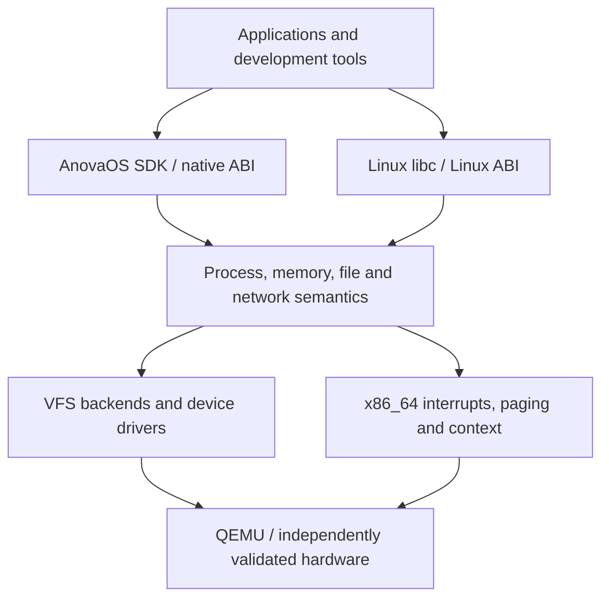

<!-- Describe implemented kernel, user-space, GUI and reconstruction ownership boundaries with separately scoped future architecture. -->
# Architecture

**English** | [简体中文](../zh-CN/ARCHITECTURE.md)

This describes implemented boundaries through the accepted M15.6 reconstruction profile and
separately scoped future architecture. Guest toolchains, native SDKs and bounded Rust GUI/GPU
profiles are implemented; full compiler reconstruction, guest-only image generation, SMP and
physical hardware remain separate. M16 now implements the backend/cache boundary and a
controlled ext4 profiles, explicit JBD2 recovery and opt-in migration/build acceptance; M17.1 has an initial host-checked session implementation; QEMU acceptance and M17.2–M17.5 remain pending. Current evidence is in [STATUS](guides/STATUS.md).

## 1. Overall structure

Use a modular monolithic kernel. Move system-service policy into user processes as actual
requirements arise; initial drivers remain in kernel with explicit ownership/isolation boundaries.



Native/Linux personalities share internal resources and semantics. Convert interface differences
at the adapter rather than maintain disconnected process/filesystem implementations.

## 2. Boot and platform boundaries

UEFI launches Limine, which loads the ELF/initramfs and supplies the locked memory map,
RSDP/HHDM/framebuffer responses. Establish data ownership and initialization order immediately:
best-effort serial → response validation → essential data/reservations → bounded early mappings/
exceptions → ACPI/APIC/timer → owned pages/heap → tasks/VFS → init.

Existing bootloader mappings are not automatically kernel-owned. Do not depend on firmware
services after their lifetime ends. Rust's UEFI target builds UEFI programs; the kernel uses
its separate bare-metal target. The initial platform is q35/OVMF/COM1 and modern virtio PCI
block/net; other devices are added only with drivers/gates. M1 does not need virtio.
QEMU PS/2 input does not establish real USB keyboard support.

### Current boot and M2 BSP implementation

- Limine 9.5.0 + `limine = 0.5.0` validate base revision 3, UEFI64, four-level
  paging, HHDM, the memory map and kernel reservation. Writable requests remain
  protected by linker `KEEP`. Boot responses and all original memory stay live.
- `arch/x86_64/` installs GDT/TSS/256 IDT gates through stable assembly entries.
  Three static 16 KiB IST stacks have removed 4 KiB guard mappings. Breakpoints
  return through `iretq`; fatal exceptions report the full GPR frame, CR2 and
  decoded #PF/#GP error fields. A real stack failure reaches #DF on IST1.
- A bounded 32-page pool clones the active root and only the modified table
  paths. It preserves all other Limine mappings. Guard pages and explicit
  read-only NX ACPI / UC NX APIC windows do not require a frame allocator.
  This remains the early-boot boundary; M3 subsequently clones every live table
  into checked frame storage before switching to the owned hierarchy.
- The shared `anova-platform` crate decodes bounded ACPI bytes with checksum and
  length checks. Required tables are RSDP, XSDT/RSDT, MADT and FADT. The APIC CPU
  feature, MSR base, MADT identity, NX and PAT assumptions are checked.
- Both PICs and every discovered I/O APIC redirection remain masked. Only local
  APIC vector 64 is enabled; spurious vector 255 returns without EOI. A 20 ms
  ACPI PM-counter sample calibrates the 100 Hz periodic timer. Its handler
  increments an atomic count, sends one EOI, and never logs or allocates.
- COM1 output preserves IF while serializing normal BSP calls. Panic and fatal
  exception paths use independent bounded, lock-free emergency output. There is
  no AP startup; M5 adds the BSP scheduler below. Normal idle uses `sti; hlt` after timer validation.
- `xtask` still builds a UEFI El Torito ISO for q35/TCG, 256 MiB and one CPU, with
  disposable firmware variables and no network. M7 now attaches a temporary
  data disk by default, with explicit persistent images described below. Smoke passes only
  with ordered CPU/timer markers, 8+ IRQs, returning breakpoints and exit 33.
  Panic exits 35 and real exceptions exit 37; all are failures. The gate checks
  that each negative case reached its expected injection and diagnosis.

See [M2 CPU details](milestones/M2_CPU.md) for exact bounds, contexts and limitations,
[M0/M1 evidence](validation/M0-M1.md) for the historical boot gate, and
[M2 evidence](validation/M2.md) for the historical M2 validation.

### Historical M3 memory baseline

- `anova-memory` shares checked usable-frame allocation, buddy-heap policies and
  four-level page-table algorithms with host tests. State metadata has an explicit
  page-rounded reservation; bootloader memory and all non-USABLE ranges stay reserved.
- Every active table is cloned into owned frames. New paths roll back on OOM;
  empty tables are unlinked, locally flushed and reclaimed. Dynamic edits use
  4 KiB leaves; imported huge leaves retain backing and cache attributes.
- NX covers HHDM aliases and new data mappings; CR0.WP is enabled. A new 64 KiB
  execution stack has two absent guards and owns RSP0. The original 2 MiB buddy heap enabled
  stable Rust `alloc`, fallible OOM and a terminal allocation error diagnostic;
  M11 later raised the heap to the current 16 MiB.
- Test-only pressure validation covers complete frame exhaustion, map rollback,
  reuse, container lifetimes and coalescing. The full gate has 13 independent
  images, including real read-only/NX/guard/unmap faults and infallible heap OOM.

See [M3 memory design](milestones/M3_MEMORY.md) and [M3 evidence](validation/M3.md).
M4 adds private user roots as described below; M7 adds an owned DMA frame for virtio-blk; SMP shootdown and boot-memory reclamation remain pending.

### Historical M4 native user implementation

- `crates/elf` validates bounded static ET_EXEC input before allocation; `crates/abi`
  defines native v1 numbers, errors, checked user ranges and a 32-byte query layout.
- Each sequential invocation owns private lower tables, zeroed user pages and a
  guarded 64 KiB kernel stack, borrowing only supervisor kernel upper paths.
- SYSCALL switches immediately to the trusted stack, then returns through a
  validated IRETQ frame. User copying checks every page and recovers only the
  guarded assembly copy instruction. Synchronous user faults end one app.
- x87/SSE2 are initialized per invocation. The kernel remains SIMD-free; M5 subsequently added saved extended-state contexts
  before introducing task switching.
- Separate Rust/C user builds produce actual ELF modules with explicit ABI/hash
  inventory. Both hello apps, 11 isolation cases, two real copy fixups, partial
  OOM rollback and repeated teardown are accepted on q35/TCG.

See [M4 design](milestones/M4_USERSPACE.md), [M4 evidence](validation/M4.md),
[per-file inventory](guides/FILE_PURPOSES.md) and [DEV-001](guides/REQUIREMENTS.md).

### M5 process implementation and later thread extension

- `anova-sched` supplies bounded state transitions, parent/wait semantics, console
  descriptor ownership and round-robin policy shared with host tests.
- Each of 32 process slots owns one thread/context, private user root/pages and
  a unique 64 KiB guarded kernel stack. Trap capture returns to a separate BSP
  scheduler continuation; no Rust stack or lock is suspended across scheduling.
- User-mode timer IRQs save GPRs, segment selectors/bases and complete enabled
  x87/MMX/SSE2 state, EOI, then rotate. Kernel sections keep IF=0; idle atomically
  enables IRQs and halts. Address-space copying is pinned by these BSP ownership rules.
- Native v1 extends to spawn/exec/eager fork, sleep/yield, wait and close. Images
  come from explicit native modules; console descriptors precede M6 VFS objects.
- Exit/fault destroys inactive pages/stacks and descriptors; zombies retain only
  status until parent wait or kernel orphan reaping. Exec publishes only a fully
  loaded replacement. Partial OOM and repeated lifecycle tests require exact
  frame and heap restoration.

See [M5 design](milestones/M5_PROCESSES.md) and [M5 evidence](validation/M5.md).
The M4 section above records the earlier sequential baseline, superseded by M5.

### M6 filesystem and shell baseline

- `anova-vfs` owns boot-only initramfs/tmpfs/devfs mounts, component-wise paths,
  cwd identities, bounded nodes and shared reference-counted open descriptions.
  Independent opens have independent offsets; dup/fork/spawn share offsets and
  exec preserves descriptors/cwd. Unlink retains open data until its final close.
- Native read/open/seek/dup2/pipe/readdir/mkdir/chdir/getcwd/unlink use checked
  user copying. Blocking I/O stores only a syscall frame, drops all active user
  borrows and wakes through bounded scheduler readiness scanning at IF=0.
- One KiB pipes handle partial writes, buffer wrap, final-close EOF and broken
  readers. The console receives canonical edited lines by bounded BSP UART
  polling; LAPIC ticks wake input without external IRQ routing.
- The host packs a checked, hashed project-owned read-only archive. Native PID 1
  supervises an interactive shell; small native commands use real fork/exec/wait,
  up to four pipeline stages and file redirection. All tmpfs state is volatile.

See [M6 design](milestones/M6_FILESYSTEM.md) and [M6 evidence](validation/M6.md).
These commands are project-owned native applications. General runtime mount support remains
future work; M8/M9 later add selected Linux binaries and POSIX terminal semantics. M7 adds storage below.

### M7 storage and editing baseline

`kernel/drivers` enumerates PCI, maps bounded modern virtio capabilities UC/NX
and owns one coherent DMA32 frame until confirmed reset. Completion is polled
with PM-timer deadlines; external IRQ routing remains disabled. `anova-storage`
shares checked sector I/O and a strict one-group, 4 KiB ext2 implementation
with host tests. VFS mounts disk metadata at `/persist` and reads file data on
demand, retaining existing descriptor/offset/process ownership. An explicit
`.anova-abi` image manifest selects native v1 for executable disk files.

Ordered writes, a dirty-superblock protocol, actual FLUSH, sync/fsync and
clean unmount precede DMA teardown and restricted QEMU ACPI S5. The native
line editor and cp/install commands save source and app files; host tooling
separates temporary disks from explicit persistent images. See
[M7 design](milestones/M7_STORAGE.md) and [M7 evidence](validation/M7.md).
There is no journal, atomic editor save, crash recovery, asynchronous block layer,
hotplug or SMP. Later M12 adds bounded rename and M11/M12 add guest compilers;
these do not retroactively extend the historical M7 acceptance.

## 3. Directory responsibilities

Some paths below describe architectural responsibilities rather than existing directories;
create modules only when actual implementation requires them.

| Path | Responsibility |
| --- | --- |
| `kernel/src/arch/x86_64/` | GDT/IDT/TSS, trap/syscall entries, APIC, paging, context |
| `kernel/src/boot/` | Limine validation, boot-data ownership and initialization |
| `kernel/src/mm/` | Frames, address spaces/regions, heap, checked user memory |
| `kernel/src/task/` | Processes/threads, scheduling, signals, wait/exec lifetime; current Linux adapters |
| `kernel/src/fs/` | Kernel VFS/device integration; common VFS/ext2 policy lives in shared crates |
| `kernel/src/ipc/` (possible future split) | Pipes/events/shared-memory/local-socket integration |
| `kernel/src/drivers/` | PCI/virtio/serial/input/GPU mechanisms and future devices |
| `kernel/src/net/` | Network device/stack/socket integration |
| Native/Linux ABI adapters | Versioned native interfaces and Linux number/errno/layout/flag/frame conversion |
| `crates/abi/`, `crates/elf/`, `crates/platform/` | Shared checked ABI/ELF/platform logic without kernel hardware dependency |
| `crates/memory/`, `crates/sched/`, `crates/vfs/`, `crates/storage/` | Reusable bounded policy and host tests |
| `crates/graphics/`, `crates/input/`, `crates/gui/`, `crates/gui-runtime/` | Checked graphics/input, GUI protocol/composition policy and public user runtime |
| `user/rt/`, `sdk/` | Native CRT/syscalls/application SDK and standalone templates |
| `user/init/`, `user/shell/`, `user/compositor/` | User init/shell/tools and isolated window service |
| `user/`, `tests/guest/` | Native/Linux fixtures, GUI demos and expected behavior |
| `xtask/` | Host build/image/run/test/diagnostic/reconstruction orchestration |
| `boot/`, `linker/` | Locked protocol setup and separate kernel/user linker scripts |
| `ports/` | Third-party recipes/patches/locks and source preparation |
| `docs/en/`, `docs/zh-CN/` | Mirrored designs, guides, milestone contracts, evidence and notices |

Do not commit target outputs, generated sysroots, tool downloads or disk images. Commit recipes,
locks, patches and small first-party fixture sources. Future `user/desktop`, SDK consolidation or
ADR directories are proposals, not implementation claims.

## 4. Memory and permissions

Use 4 KiB pages/four levels, a high-half kernel and private user address spaces. Define actual
virtual regions centrally rather than copy magic constants. Typed PhysAddr/VirtAddr/UserAddr
prevent interchange. Reserve kernel/modules/framebuffer/firmware/ACPI/stacks/tables; HHDM is a
controlled access mechanism, not permission to access arbitrary physical addresses. Track cache
attributes and U/S/RW/NX; loader enforces W^X and guarded stacks. Copy user data with page/fault
checks, including nested structures; never trust a user reference. Eager fork precedes independently
tested COW. Verify lifetimes before performance changes.

## 5. Processes, threads and syscalls

A process owns address space/files/cwd/identity/signal dispositions/personality; threads own
registers, kernel/user stacks, TLS, scheduling and masks. Entry must switch trusted state/stack,
save context, dispatch by personality, validate user memory, call common services, encode the ABI
result and validate return state. SYSCALL does not switch stacks automatically. Account for
thread stack/GS/nested faults/RCX/R11/canonical return/RFLAGS; register forwarding alone is not
isolation. Use verified IRETQ before optimizing returns.

Native v1 and Linux x86_64 numbering/return conventions remain distinct. Choose personality via
explicit image/exec metadata, not OSABI guessing. Blocking/user preemption came before threads/
futex. SMP requires independently reviewed locks/per-CPU/TLB shootdown/interrupt routing.

## 6. Files, storage and terminals

VFS owns inodes/directories/open descriptions/fds/permissions/mounts. dup/fork share an open
offset, not merely copied fd integers. The sequence is readonly initramfs root, tmpfs/devfs,
virtio-blk and declared ext2 features. FAT/ESP remains boot storage rather than tool workspace.
Reject unknown ext2 features. Check sectors/indirect blocks/metadata/flush/fsync/shutdown;
nonjournaled ext2 does not promise power-loss integrity. TTY line discipline includes echo,
termios/signals/window size, with common COM1/PTY semantics. Broader editor/shell job-control
requirements remain individually scoped.

## 7. ELF, runtime and dynamic linkage

Start with checked bounded ELF64 ET_EXEC: machine/length/overflow/PT_LOAD addresses/permissions/
overlaps, zeroed BSS, argv/env/stack and Ring 3. Later add Linux auxv/TLS/static PIE. Kernel maps
PT_INTERP and executable and supplies entry metadata; the actual musl dynamic linker handles
shared objects/symbols/relocations in user space. Provide real mmap/mprotect/files/TLS instead
of rewriting a full linker in kernel. Omit vDSO auxv only where tested user space supports syscall
fallback; never provide fake addresses or capabilities. glibc remains a separate unverified profile.

## 8. SDK and development environment

M4's minimal no_std runtime grew into M13 SDK. Tested Linux-musl std is available; an AnovaOS
native target/libc/std platform port is separate. Keep kernel ELF, native user ELF and Linux
ELF metadata/ABI/compiler/sysroot identities distinct. Packages and kernel images are different
release units; compilers have their own sysroots. Provide `/tmp`, `/dev`, any required `/proc`
and interpreter paths according to actual measured tool needs, not invented compatibility data.

## 9. Implemented M14 display/input and graphical userland/SDK architecture

The optional **M14.1 software display and M14.2 polled PS/2 input/cursor are
implemented and locally verified**. The M14.3 isolated user-space compositor
and the M14.4 GUI runtime/SDK are locally accepted. M14.5 now verifies a bounded
hardware offscreen clear/readback path with CPU fallback; ordinary desktop
composition remains software-rendered. The authoritative design and the
independently gated M14.1–M14.5 stages are in
[M14_GUI](milestones/M14_GUI.md), with stage status in [ROADMAP](ROADMAP.md)
and [STATUS](guides/STATUS.md).

AnovaOS implements its GUI engine in Rust and exposes equivalent **Rust,
C++, and C application SDKs**. A Rust GUI runtime supplies rendering, text,
layout, widgets and events. Its stable inter-language FFI is a **versioned
C ABI implemented in Rust** (C headers; C++ move-safe RAII; safe Rust crate),
not a direct wrapper around privileged kernel calls. All language clients
use a single documented semantic contract; the Rust SDK may optimize its
internal call path without changing observable behavior.

```text
Rust app / C++ app / C app
     |       |       |
Rust SDK / C++ SDK / C SDK
            |
   Rust GUI runtime + C ABI
            |
   versioned IPC / private copied surfaces
            |
   Rust compositor (user process)
       |            |
  CPU renderer   optional GPU renderer
       \           /
kernel IPC, mappings, display and input drivers
            |
       QEMU / hardware
```

The kernel retains buffer/memory permissions, IPC isolation, display and input
device access; windows, focus, text rendering, widgets and the desktop shell
belong to user-space components. The kernel authenticates process identities;
the compositor validates window ownership and owns presentation, stacking,
input routing, buffer lifetime and quotas.
Clients do not receive unrestricted framebuffer mappings. All display
formats/strides, damage regions, memory lengths, object handles, concurrency,
events and crash/restart paths must be bounded, versioned and verified.

GUI ABI rules: `extern "C"` exports; `#[repr(C)]` and explicit-width fields;
no Rust-owned collection layouts, implicit shared allocators or unwinding
across FFI; opaque handles and precise release ownership; explicit errors
and version/capability checks; documented thread/callback semantics. Keep
the native syscall ABI, GUI library ABI and Linux compatibility personality
distinct. Build and execute independently validated Rust, C and C++ GUI apps,
with incompatible-version and malformed-input tests.

M14.1 establishes validated framebuffer + software drawing. M14.2 delivers
bounded physical keyboard/pointer events to a diagnostic consumer and clips a cursor. M14.3 introduces an isolated user-space
compositor and two-window behavior. M14.4 adds GUI runtime, graphical terminal,
C/C++/Rust SDKs and separately tested demo applications. M14.5 optionally
adds actual GPU-accelerated rendering with software fallback. A bootloader
framebuffer or virtio-gpu display scanout does not prove GPU rendering support;
Vulkan/OpenGL, Wayland/X11, SDL/Qt and Linux GUI application compatibility
remain separate, version-specific ports. SMP and real-hardware expansion are
independent future workstreams, not implicit M14 GUI completion criteria.

The implemented `crates/graphics` library owns no hardware or allocator; callers
supply RGB storage. The optional kernel boot diagnostic validates the complete
framebuffer byte reservation and page-rounded overlap safety, checks inherited
supervisor RW/NX PAT5 WC mappings without creating an alias, then writes/readbacks
the test pattern through volatile byte accesses and MFENCE. Temporary heap
storage is reclaimed before user startup. COM1 remains the recovery console.
This adds no window/widget/font policy or application display capability.
See [M14.1 evidence](validation/M14.1.md).

`crates/input` is dependency-free `no_std` logic for native set-1 keyboard and
standard ID-0 three-byte mouse decoding, a 64-entry dispatcher and clipped
pointer state. The optional `kernel/src/drivers/input.rs` owns i8042 ports,
source/ACK validation and bounded PM-timer initialization. The sole BSP scheduler
polls at IF=0 on its permanent kernel root, consuming at most 64 bytes and
64 events per pass; IRQ1/12 remain masked. Per-device partial-sequence timeouts
and malformed/overflow/disconnect resets invalidate held keys/buttons.
The temporary diagnostic consumer receives physical events only; it does not
convert them to COM1 text or implement user-space focus/routing policy.

The cursor keeps one fixed 7×9 packed device-pixel save area, restores the prior footprint,
preserves unused pixel channels, clips every device access and orders WC stores. Input/cursor state allocates no
heap. The original boot pattern stays intact until a pointer event displays
the cursor. `input-test` supplies QMP input and checks every pixel at five
positions, plus no-display/no-controller serial recovery and test-only reset,
consumer reconnect and actual controller-port stop/reinitialization cases.
See [M14.2 evidence](validation/M14.2.md) for acceptance status. This path
adds no USB, physical hotplug, external IRQ or real-hardware support claim.

Implemented M14.3 boundaries are `crates/gui/` for wire types and bounded
composition policy, `kernel/src/gui.rs` for authenticated copied transport and
exclusive display/input access, and `user/compositor/` for the window server.
The compositor owns private surface copies, damage, stacking, focus and input
routing. Client/server exit, fault and exec release transport resources; session
changes invalidate old handles. Actual heap OOM, mailbox pressure, two separate
client processes and both client/server #UD recovery are tested. No shared
user mapping or device address reaches clients. See
[M14_COMPOSITOR](milestones/M14_COMPOSITOR.md) and
[M14.3 evidence](validation/M14.3.md). M14.4 implements drawing/widgets and the ABI in `crates/gui-runtime/`, with the
companion C/C++ source SDK in `sdk/gui/`. A broader `user/desktop/` remains future work;
the earlier proposed `user/gui-runtime/` and `user/gui-sdk/` paths are not the delivered layout.
Evaluate `embedded-graphics`, `tiny-skia`, `fontdue` and `cbindgen`
only against tested guest targets, license, dependency and safety constraints
before selecting them as actual dependencies.

## Implemented M8 Linux boundary

The explicit initramfs Linux executable kind selects a separate syscall personality.
`kernel/task/linux.rs` translates Linux registers, errno, stat/dirent formats,
TLS and bounded process/memory calls; generic VFS and scheduler policy retain
backend-neutral types. Startup stacks expose checked argv/envp/auxv. Native disk
image policy remains native v1. Static musl and a pinned BusyBox profile are
verified as the historical M8 baseline. M9 adds the bounded runtime below;
general Linux compatibility remains unverified. See [M8 design](milestones/M8_LINUX.md).

M8 optimization keeps page-bounded C-string/vector decoding in
`crates/abi/src/linux/strings.rs`, parameterized by the kernel's checked copy
operation. Exec fills owned buffers in place; no user reference survives the
activation boundary. The native/Linux stack encoder places payload and words
once. `kernel/task/linux/io.rs` imports descriptor arrays before I/O and retains
partial-write progress independently of later user-buffer faults.

## Implemented M9 runtime boundary

The scheduler now admits process leaders and Linux threads in the same 32-slot
pool. A shared address-space owner, anonymous backing, descriptor tables and
signal actions use fallible single-thread reference counting from
`crates/memory/src/shared.rs`; no kernel/hardware dependency is introduced into
VFS. Root/page-table destruction precedes the last backing release, and no
Shared/RefCell borrow crosses user execution. Process traps retain 64 KiB guarded
stacks; the historical scheduler continuation used a separate 128 KiB guarded stack;
M11 increased it to the current 256 KiB.

`kernel/task/linux/threads.rs` translates clone/futex/group exit and deadlines;
`signals.rs` translates AMD64 frames and checked sigreturn; `terminal.rs` handles
poll/ppoll, ioctls and group/session requests; `memory.rs` handles mmap/mprotect.
The common VFS retains descriptor/open/pipe semantics, while `kernel/fs/tty.rs`
owns bounded COM1/PTY line disciplines. The ELF parser validates executable and
interpreter metadata; the kernel maps both and supplies auxv, then the real musl
loader performs relocation/symbol/TLS work in user space.

Dynamic fixtures and test transcripts remain distinct from kernel mechanisms.
See [M9_RUNTIME](milestones/M9_RUNTIME.md) for flags, locking/ownership, unsupported
operations and [validation/M9](validation/M9.md) for observed results.

## M10 implemented network and package boundary

`drivers/network` owns modern virtio-net DMA and separate RX/TX queues;
`net` integrates pinned no_std smoltcp on the single scheduler clock. Generic
VFS open descriptions carry opaque socket IDs so fork/dup/exec/close share the
existing lifetime model. Linux sockaddr/flags/errors and interruptible syscall
frames stay in `task/linux/sockets`. CMOS UTC supplies checked realtime; LAPIC
supplies deadlines. Peripheral IRQs remain masked.

DNS, TLS and package policy run in actual guest user processes. The TLS library
validates CA/name/date, while package locks, ABI/SDK/license checks and alternating
ext2 slots validate and publish installation state. User data has a separate
persistent directory. See [M10 profile](milestones/M10_NETWORK_PACKAGES.md) for bounds,
controlled-online scope, build inputs and unchanged power-loss limitations.

## M11 implemented development boundary

The optional development archive mounts the source-built GCC/G++/binutils/make
profile and matching musl/CRT/C++ sysroot at `/tc`. Guest launchers select the
tested static application configuration. Linux disks declare personality in
their manifest, including new files; native policy remains explicit.

The kernel supplies suspended-parent vfork, private regular-file snapshots,
checked larger ELF/argument/memory bounds, file modes and UTC modification times.
All compilation still occurs in isolated guest processes; the host constructs
tools and independently inspects persisted guest outputs. Memory remains eager,
single-core and bounded; the development heap is 16 MiB and scheduler stack is
256 KiB. Development Rust builds use opt-level 1 with debug information.
See [M11_TOOLCHAIN](milestones/M11_TOOLCHAIN.md) for ownership and limits and
[M11 evidence](validation/M11.md) for actual acceptance.


## M12 implemented Rust development boundary

The optional Rust archive adds independently checksum-locked upstream musl
rustc/Cargo/std and LLVM rust-lld at `/rs`, beside M11's source-built `/tc` C
sysroot. Linux personality remains explicit. Host tooling prepares these tools;
actual accepted applications, build scripts and procedural macros compile in
guest processes. Vendor archive/file checksums and Cargo.lock govern offline
resolution. Rust source reconstruction and bootstrap are separate work.

Per-thread alternate-stack state lives with Linux thread state; shared signal
dispositions remain group-owned. Musl posix_spawn uses the explicitly supported
shared-VM vfork process variant. Child waits use the thread-group parent identity
and block only the calling thread. Detached Linux threads may remove their own
stack before exit; return checks still validate user canonicality and executable
RIP, and invalid return cannot be suppressed by ignoring/blocking SIGSEGV.

VFS open descriptions own advisory locks and shared offsets. AF_UNIX packet
pairs use two bounded pipe-pool queues, retain message boundaries and release
peer writer/reader ownership only on the endpoint's final close. Positioned I/O
restores its private cursor before returning to the scheduler. Bounded file
resize/regular rename preserve open inode ownership. Empty-directory removal
retains an open inode and reclaims it on final close; live cwd and removed-open-
child references return busy to protect parent identities. Same-parent directory
rename accepts only a new destination name, preserving dot-dot/parent links; ext2 mutation failure
retains its failed-device state. The Rust linker writes through file syscalls
rather than writable shared-file mappings. Linux-only startup, ELF
and mmap bounds expand independently of the native ABI. Internal directory
records carry 255-byte components and 512-byte paths; Linux getdents serializes
these separately from native v1's fixed 80-byte record, whose adapter rejects
unrepresentable names without advancing. mmap hints publish only
on successful allocation. See [M12_RUST](milestones/M12_RUST.md) for exact bounds and
[acceptance](validation/M12.md) for actual guest/reboot evidence.

The online continuation adds Linux select with imported descriptor masks,
monotonic deadlines and preserved signal-interruption frames. Readonly shared
file mappings own a versioned VFS inode lease and physical-page metadata; they
refresh successful file writes before the next user execution. Fork retains
both owners, while munmap/exec/exit release them. Mapped inodes outlive close,
unlink and name replacement. Writable shared-file mappings remain rejected;
this is not persistent mmap writeback. File timestamps retain access/modify/
change fields, and explicit ext2 updates use the existing checked disk writes.
M16 replaces eager ext2 import with on-demand backend lookup and streaming directory cursors;
directories remain pinned within the node quota, while inactive regular-file nodes can be evicted.

`cargo-online` is an explicit launcher policy over the same official Cargo;
networking, TLS, archive extraction and Git operate in user space. It preserves
explicit Cargo environment settings, uses `/persist/cargo-home` by default and
supplies the pinned public CA store without disabling verification. Ordinary
Cargo remains offline by default. The independent controlled/public gates and
resource/transport boundaries are in [M12_NETWORK](milestones/M12_NETWORK.md).

## M13 delivered SDK and application boundary

The [M13 SDK](milestones/M13_SDK.md) exports source SDK 1.0.0 independently from the
frozen native syscall personality. `user/rt/src/v1.rs` adds typed errors and
descriptor ownership; `sdk/` supplies C/C++/Rust templates, the user linker and
standalone host builder. `xtask/src/sdk.rs`, `app.rs` and `packages.rs` provide
create/build/pack/image/install acceptance without kernel-target flag leakage.
ANOVAPK2 declares architecture, ABI, entry, dependencies and admission
requirements. The VFS pins `/persist/.anova-abi` as immutable mount authority,
and the installer rejects a target mismatch before writing. Native and static
Linux package profiles remain distinct. Permission declarations do not add a
process sandbox. The GUI library uses the independent versioned ABI described below; dynamic GUI
service admission remains separate.

`kernel/src/task/diagnostics.rs` copies bounded user frame-pointer records after
a captured hardware fault; `xtask/src/debug.rs` resolves addresses on the host
against retained exact ELF symbols. The kernel does not parse DWARF or run a
GDB stub. See [M13 validation](validation/M13.md).

## M14.4 user GUI library boundary

`crates/gui-runtime` adds the allocation-free Rust user-library boundary
`anova.gui.v1`, separate from native syscall v1 and the experimental compositor
wire version. Fixed C records and process-local generation handles back generated
C declarations, C++ move-only RAII and safe Rust wrappers. The library owns one
private RGB raster, original bitmap glyphs, clipped primitives, layout, immediate
widgets, a 32-event reset queue and bounded private UTF-8 clipboard. The accepted
M14.3 compositor retains authenticated owner/session checks and window policy.
No client receives display addresses or another process's raster storage.

`user/linux/gui-build.c` executes the existing guest C/C++ and Rust compilers.
Their runtime/compiler personality remains Linux-musl; their freestanding
client output is explicitly admitted as native by the persistent volume marker.
`user/gui-link.rs` links native startup, memory intrinsics and panic termination
with the guest-built Rust rlib. `user/gui-run` supervises the isolated compositor
and client using actual wait statuses. The Rust graphical terminal starts its
pipe/command helper before GUI initialization so it never forks a live GUI owner.
This developer profile provides no native libc/`std`, GPU driver or Linux GUI ABI.
See [runtime contract](milestones/M14_RUNTIME.md).

## Bounded M14.5 GPU drawing

The optional `gpu` feature owns a secondary modern virtio-gpu control queue
and private coherent DMA32 pages. Only the authenticated user compositor can
request a bounded offscreen clear/readback; dimensions, color, reserved fields
and writable output pointers are checked before any device submission. No raw
VirGL command stream or device mapping is exposed to applications.

Every device response is fenced and length/context/used-ring checked. A
completed readback is copied through owned staging memory to the caller; the
compositor chooses CPU fallback and presents through the existing VGA path.
Reset acknowledgement precedes DMA release. Failed reset quarantines exposed
pages and permanently disables reuse. The test profile checks actual hardware
renderer identity, pixel output, lost-doorbell timeout/reset, CPU fallback and
hardware reinitialization. See [M14 GPU](milestones/M14_GPU.md) and
[validation/M14.5](validation/M14.5.md) for exact scope and evidence.

## Bounded M15 source reconstruction

The optional `bootstrap-metrics` kernel feature samples resource use at scheduler
boundaries and emits a per-instance summary before successful ACPI shutdown. It
adds no syscall ABI and changes no resource policy. `xtask bootstrap-prepare`
imports locked unmodified bzip2 sources into a new Linux-personality work disk;
`bootstrap-test` separately boots capacity rejection, guest GCC reconstruction
and reboot/compiler-failure recovery. Only the guest links the reconstructed
bzip2 ELF. Physical-frame deltas include kernel allocations and omit transient
syscall peaks; end-of-boot storage usage is separate from transient demand.
The original bzip2 acceptance changed no disk format, file/heap/task/descriptor
limits or native ABI. M15.5 below separately raises persistent file capacity
while retaining tmpfs and shared-cache bounds. See [M15 bootstrap](milestones/M15_BOOTSTRAP.md) and
[local evidence](validation/M15.1-M15.2.md).

The separate `bootstrap-gcc-test` assessment audits seven locked source archives
without extracting complete trees, packages a bounded configure-startup subset
and reuses M11 seed tools. Actual guest probes compile/run a C++11 fixture,
reject missing GMP/MPFR/MPC headers and build-tool execs, capture the upstream
configure entry-point rejection and exercise resource recovery. A second boot
checks retained fixture execution and exact persisted hashes. The host records
its diagnostic compilation, imported sources, seed inventories and image
identities explicitly. A successful assessment may conclude that construction
is blocked; no new compiler stage or capacity enlargement is implied. Full
source inventories include optional tests/docs and are not minimum build
requirements. See [M15 GCC feasibility](milestones/M15_GCC.md) and
[execution evidence](validation/M15.3.md). Compiler source bootstrap remains separate; the M15.5 kernel reconstruction
boundary and its executed scope are described below.


## M15.4 independent Rust/LLVM/Cargo feasibility boundary

`ports/bootstrap/rust_probe.py` authenticates the complete locked Rust source distribution,
audits rustc/LLVM/Cargo/vendor separately, records prescribed stage0, and publishes only a bounded
unchanged prerequisite subset. `xtask/src/bootstrap_rust.rs` runs real inherited Rust std/C++17
seeds, missing-tool exec checks, Python entry rejection, isolated offline Cargo dependency failure
and retained-output/compiler-rejection/reboot checks. The inherited Rust 1.90.0 binary is not
prescribed 1.89.0 stage0. No compiler component is reconstructed; full distribution inventories
are not minimum build closures. See [M15 Rust](milestones/M15_RUST.md) and
[validation/M15.4](validation/M15.4.md).

## M15.5 guest kernel reconstruction boundary

`ports/bootstrap/kernel_prepare.py` snapshots exact first-party kernel and crate
sources and authenticates complete locked registry archives. Its generated root
workspace omits host xtask dependencies and records every metadata adaptation.
Official matching bare-metal core/alloc/compiler_builtins remain inherited
binary seeds, overlaid read-only at `/rs` beside the Linux-musl compiler tools.
The readonly `/ks/source` tree avoids consuming persistent inodes for inputs.

The host-built guest recipe `ports/bootstrap/kernel-build.c` drives actual
Cargo/rustc/rust-lld processes, captures logs and atomically publishes only a
validated high-half static kernel ELF. Explicit target selection isolates
kernel flags from Linux-musl build scripts. Persistent outputs can reach
4 MiB within the existing ext2 single-indirect layout; tmpfs and readonly shared
caches retain their 1 MiB bounds. Active shared caches prevent oversized growth,
while inactive caches are discarded before persistent growth. Each ext2 write
snapshots its indirect table once, avoiding repeated device reads while
preserving per-operation bounds and ordered pointer/length publication.

`xtask/src/bootstrap_kernel.rs` retains the guest ELF, packages it through an
image path that never rebuilds a kernel, independently compares ISO kernel
bytes, then requires its embedded source/seed/recipe identity during actual
boot and failure/recovery sessions. The host still supplies locked seeds,
creates the initial work disk and boot images, extracts the guest output and
packages the accepted kernel. This is separate from compiler reconstruction and guest-only image generation;
M15.6 below independently verifies the declared repeat-build comparison. See
[M15 kernel](milestones/M15_KERNEL.md) and [status](guides/STATUS.md).

## M15.6 independent build comparison boundary

`xtask/src/bootstrap_repeat.rs` runs both accepted reconstruction gates twice
sequentially. Each gate checks a source-only or empty initial work disk before
compilation. The orchestrator snapshots all repository source bytes, verifies
source stability, archives each stopped disk, ISO, initramfs, manifest and log
before the next invocation, and requires matching declared input/seed/recipe
identities and full bzip2 output/kernel ELF bytes. Failure leaves diagnostic
evidence and no successful aggregate result. Each component retains its own
compiler-rejection, reboot and filesystem checks.

Metadata differences, including kernel intermediate output differences, remain
recorded separately from final artifact equality. No source or artifact is
normalized to force a match. Compiler source reconstruction, complete guest-only
image generation, power-loss recovery and general reproducibility remain
separate. See [M15 repeat](milestones/M15_REPEAT.md) and
[local evidence](validation/M15.6.md).

## M16 storage/resources and planned M17 desktop

The backend/cache boundary and controlled ext4 readonly-v1 below are implemented.
Opt-in write-v1, JBD2 and migration have bounded acceptance below; resource expansion and the desktop retain their independent exits.
See [M16 evidence](validation/M16.md).
[M16 foundation](milestones/M16_FOUNDATION.md) precedes
[M17 desktop](milestones/M17_DESKTOP.md); see [ROADMAP](ROADMAP.md) for stages.

- `crates/storage/src/filesystem.rs` separates checked sector I/O from volume policy.
  Backends declare root inode, file capacity, timestamp quantum, format and readonly state.
  VFS owns one backend with immutable native/Linux ABI admission metadata. Persistent stat
  identities use a separate 64-bit range independent of cache slots; directory cookies are
  backend byte positions, including Linux getdents `d_off`. Native v1 layouts are unchanged.
- Mount publishes only the root and ABI marker. Lookup loads metadata on demand; readdir
  streams without caching every child. Cache vectors start at 32 slots and grow fallibly
  within 2,048. Inactive regular-file nodes can be evicted; directories/cwds, open descriptions,
  mapped files and the marker are pinned. Reserving a node slot precedes ext2 mutation.
  The 16 MiB heap, 32 task/fd and existing mapping quotas are retained. This is bounded
  metadata reclamation, not unconstrained directories, memory growth or nonblocking I/O.
- `crates/storage/src/ext4.rs` reads the strict non-journal, 4 KiB/256-byte-inode
  extent profile. It checks multiple local groups, metadata reservations/allocation,
  extent depth/visited blocks/order/overlap and bounded file sizes. Unknown features,
  dirty/recovery-required images, checksummed/64bit/flex/indexed layouts and unsupported
  inode types fail closed. Sparse/unwritten regions read as zeros. No sector write or
  flush is issued by this readonly backend. Ext2 remains the default writable recovery
  profile; JBD2 recovery and verified copy migration use the separate opt-in contracts below.
- Explicit `ext4-write` kernels admit [write-v1](validation/M16.4.md) only after auditing
  global block ownership, namespace links and allocation counters. Bounded unpublished overlays
  protect old bytes/names on preflight ENOSPC/OOM/read failures; data/flush/metadata publication
  errors poison the mount and retain dirty state. Allocation/free, extent reconstruction,
  directory moves/replacement, orphan close/unmap retries, modes and second-resolution times
  share the existing backend boundary. Shared readonly mappings and cwd identity stay pinned.
  The profile has no journal or crash recovery; ordinary kernels still mount ext4 readonly.
- Keep desktop/session/compositor policy in Rust user processes. A PTY terminal connects
  the native GUI to explicitly admitted Linux-musl shell/compiler processes. Extend
  transport/SDK bounds only with version/ownership tests; retain the C/C++/Rust contract.
- Expose actual logs and measured global resource capacity, and define authorization for
  task/service controls. Recover user-space client/compositor failures through checked
  lifecycle operations; retain COM1/QEMU/host recovery for boot, kernel or display failure.

M18 compiler reconstruction and guest-only image generation continue independently after
the developer desktop. Native std, SMP, device IRQ/async I/O and physical drivers remain
separate architecture changes. A new filesystem format is outside the M16/M17 critical path.

## M16.5/M16.6 journal and development-volume ownership

`ext4/journal.rs` owns the immutable internal journal map, checksum-v3 records,
fallible descriptor staging and a single synchronous data-plus-metadata transaction.
It flushes recovery admission, journal head, log, commit, home checkpoint and head
retirement in order. Replay validates checksums, immutable geometry, allocation,
namespace and orphan ownership in an overlay before writing home blocks. The
classic superblock/inode orphan chain shares each unlink/reclaim transaction.
No VFS/native ABI change or new scheduler/device policy is required.

`foundation_migrate.rs` opens ext2 sources readonly and copies to create-new ext4
images, compares inventories and retains the source. Its guest supervisor runs
real make/GCC/bzip2 and an independent storage writer, executes foreground commands,
fsync/rename saves, reads compiler logs and interrupts a process group. Host UART
wall times are separate from scheduler-boundary resource samples. See
[M16.5](validation/M16.5.md) and [M16.6](validation/M16.6.md). Default ext2, fixed
heap/task/cache bounds, M17 desktop and M18 compiler/image reconstruction remain separate.

## M16 allocation observations

The optional filesystem `usage` snapshot performs no allocation or device I/O. Ext4
updates current/peak block and inode counts only after successful mutations and
initializes them from the post-replay superblock on mount. The VFS forwards these
observations; bootstrap diagnostics capture final orphan cleanup before detaching
the device. This adds no native ABI or scheduling policy. The capacity gate compares
final counters with the stopped disk and keeps pressure/build sessions independent.
See [M16 capacity](validation/M16_CAPACITY.md).

The actual fresh-ext4 kernel run at `e2db30f` stayed within existing quotas:
9,494,480 sampled heap bytes, 142,825 additional frames, 1,564 VFS slots,
14 tasks and 16 FDs/process; disk allocation peaked at 6,072 blocks / 241 inodes.
Separate pressure reached the heap, all VFS/task/FD slots and disk ENOSPC, then
the same recovered disk completed construction and new-kernel boot recovery.
These observations size the declared non-GUI recipe; broader workloads require
independent measurements. Complete results and raw logs are in the capacity record.

## M17.1 initial session boundary

The separate experimental `0x101` native process-control call validates version and exact direct-child identity before nonblocking wait or signal-15 stop. It shares checked status copying and kernel lifecycle cleanup. Rust userland owns the launcher, fixed executable list and three-replacement policy; init runs COM1 independently. Desktop builds reuse existing C/C++/Rust GUI clients through a native-only archive. GUI/native v1 records and global quotas are unchanged. Actual QEMU cleanup, persistence and capacity acceptance remain pending; see [M17.1](validation/M17.1.md).
