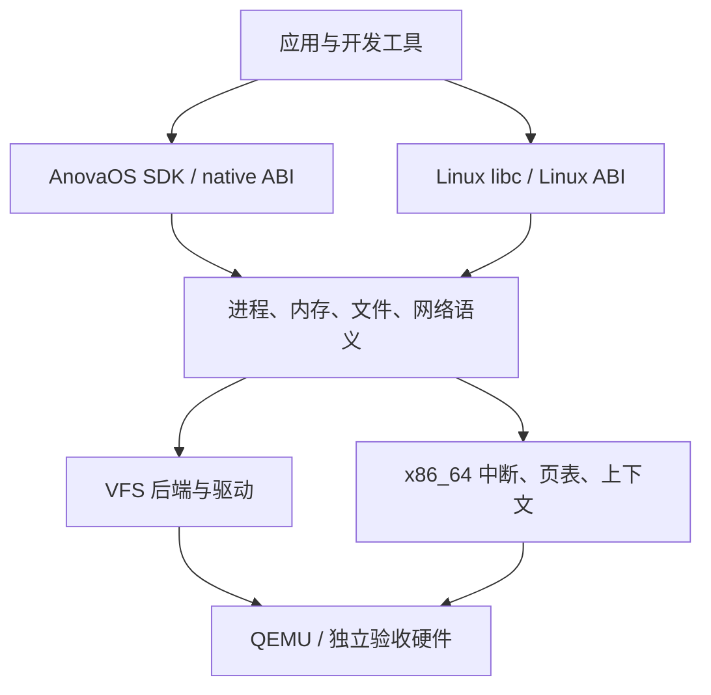

<!-- Describe implemented kernel, user-space, GUI and reconstruction ownership boundaries with separately scoped future architecture. -->
# 架构设计

[English](../en/ARCHITECTURE.md) | **简体中文**

本文覆盖至 M15.6 已验收重建及 M16 后端/缓存、受控 ext4 只读配置的实现边界。
M16 已增加显式 JBD2 恢复和可选迁移/构建验收；M17.1 会话已完成有界输入/故障/重启本地验收，M17.2 的 PTY 终端已本地验收，M17.3 有界文件/编辑器及真实 GUI 存储故障已本地验收；M17.4–M17.5 待完成。guest 工具链、原生 SDK、
有界 Rust GUI/GPU 均已实现；完整编译器重建、guest 独立镜像生成、SMP 和实机另计。
当前能力与证据见 [STATUS](guides/STATUS.md)。

## 1. 总体结构

采用 Rust 模块化单体内核，按实际需要将服务策略移入用户进程；早期驱动位于内核并明确所有权/
隔离。native/Linux personality 共用内核资源语义，接口差异在适配层转换，不另建脱节的进程/
文件系统实现。



## 2. 引导与平台边界

UEFI 启动 Limine，装载 ELF/initramfs 并传递锁定协议的 memory map/RSDP/HHDM/framebuffer。
初始化顺序为尽力串口→响应检查→必要数据/保留→早期映射/异常→ACPI/APIC/时钟→受管页/堆→
任务/VFS→init。引导器已有映射不自动归内核所有；固件服务生命周期结束后不依赖它们。
UEFI target 用于 UEFI 应用，内核使用独立裸机 target。初期 q35/OVMF/COM1、现代 virtio PCI
block/net；其他设备须有驱动/验收。M1 不需 virtio，QEMU PS/2 不代表实机 USB 支持。

### 引导与 M2 BSP 实现

- Limine 9.5.0、`limine = 0.5.0` 检查 base revision 3/UEFI64/四级页表/HHDM/内存图/内核
  保留，链接 KEEP 保留可写请求，响应与原始内存保持存活。
- `arch/x86_64/` 稳定汇编入口安装 GDT/TSS/256 IDT；三个静态16 KiB IST栈移除4 KiB guard。
  breakpoint 经 iretq 返回，致命异常报完整 GPR/CR2/解码#PF/#GP，真实栈失败到 IST1 #DF。
- 早期32页池克隆当前root及修改路径，保留其他Limine映射；guard、只读NX ACPI/UC NX APIC
  窗口不依赖frame allocator。M3后完整克隆所有活动表到受管frame。
- `anova-platform` 按有界字节/校验和/长度解析 RSDP/XSDT或RSDT/MADT/FADT；检查APIC CPU
  feature/MSR base/MADT身份/NX/PAT。
- 双PIC和IOAPIC路由全屏蔽，仅LAPIC向量64；spurious255无EOI返回。20ms PM采样校准100Hz，
  handler只加原子计数/一次EOI，不日志/分配。
- COM1普通BSP调用串行化且保留IF，panic/fatal独立有界无锁输出，无AP启动；M5加BSP调度，
  timer验证后普通idle用sti;hlt。
- xtask生成q35/TCG、256MiB/单CPU UEFI El Torito ISO，临时固件变量、无网络；M7默认临时盘。
  smoke要CPU/时钟顺序标记、至少8 IRQ、断点返回、exit33；panic35、真实异常37均失败，
  每个负例要真正到注入和诊断。

见 [M2](milestones/M2_CPU.md)、[M0/M1历史证据](validation/M0-M1.md)、[M2证据](validation/M2.md)。

### M3 内存实现

`anova-memory` 共享USABLE frame、buddy堆和四级页表策略/宿主测试，元数据显式页对齐保留，
引导及非USABLE全保留。活动表完整克隆到自有frame；新路径OOM回滚，空表先解除/本地flush再
回收。动态编辑用4KiB叶，导入大页保留backing/cache属性。HHDM别名和数据NX、CR0.WP、64KiB
双guard执行栈持有RSP0；历史2MiB buddy启用alloc/可失败OOM/终端分配诊断，后续扩大16MiB。
测试覆盖全frame耗尽、映射回滚/复用/容器/合并、13镜像真实只读/NX/guard/unmap及不可失败堆OOM。
M4加私有root，M7加DMA；SMP shootdown/引导内存回收未做。
见 [设计](milestones/M3_MEMORY.md)、[证据](validation/M3.md)。

### M4 历史原生用户态实现

`crates/elf` 分配前验证受限静态ET_EXEC；`crates/abi`定native v1编号/错误/用户范围/32字节query。
每次顺序调用拥有私有下级页表、零页、64KiB guard内核栈，只借supervisor高半映射。
SYSCALL立即切可信栈，验证IRETQ返回；usercopy逐页检查，只恢复guarded汇编复制指令故障。
同步用户异常结束该app，逐调用初始化x87/SSE2，内核不用SIMD；M5后加完整保存再切换。
独立Rust/C构建带显式ABI/hash的ELF模块；两个hello、11隔离例、两实际copy fixup、部分OOM和重复
拆卸q35/TCG通过。见 [M4设计](milestones/M4_USERSPACE.md)、[证据](validation/M4.md)、
[文件用途](guides/FILE_PURPOSES.md)、[DEV-001](guides/REQUIREMENTS.md)。

### M5 进程与后续线程扩展

`anova-sched`共享有界状态/parent-wait/控制台fd/轮转策略。历史32进程槽各有一线程/上下文、
私有root/页、64KiB guard栈；trap返回独立BSP调度续体，无Rust栈/锁跨调度暂停。
用户timer保存GPR/selector/base/完整x87-MMX-SSE2，EOI后轮转；内核IF=0，idle原子开IRQ并HLT。
BSP所有权钉住地址空间复制。native v1扩展spawn/exec/eager fork/sleep/yield/wait/close，
镜像来自显式native模块；控制台fd早于M6 VFS。exit/fault拆非活动页/栈/fd，zombie仅保留status
至wait或孤儿回收；exec只公布完整新镜像。部分OOM/重复生命周期要frame/heap精确恢复。
M5替代M4顺序运行，M9后进程/线程共享32槽。见 [设计](milestones/M5_PROCESSES.md)、[证据](validation/M5.md)。

### M6 文件系统与shell基线

`anova-vfs`拥有boot-only挂载、逐component路径/cwd、有界节点、引用计数打开描述。
独立open独立offset，dup/fork/spawn共享，exec保留fd/cwd；unlink到最后close才释放数据。
native read/open/seek/dup2/pipe/readdir/mkdir/chdir/getcwd/unlink受检复制；阻塞只保存syscall
frame，释放用户借用，IF=0由有界就绪扫描唤醒。1KiB管道处理部分写/环绕/EOF/broken reader。
BSP UART轮询编辑canonical行，LAPIC唤醒而不依赖外设IRQ。宿主打包有界哈希只读归档，PID1监督
交互shell，真实fork/exec/wait、最多四管道和重定向；tmpfs全易失。普通runtime mount后置，
M8/M9后来增加Linux/选定POSIX终端。见 [设计](milestones/M6_FILESYSTEM.md)、[证据](validation/M6.md)。

### M7 存储与编辑基线

内核PCI枚举/有界modern virtio UC-NX映射，DMA32 frame保留至reset确认。PM期限轮询完成、
外设IRQ禁用。`anova-storage`共享扇区I/O和严格单块组4KiB ext2/宿主测试。VFS在`/persist`
导入元数据、按需读数据，保留fd/offset/进程所有权；`.anova-abi`显式选磁盘可执行personality。
有序写、dirty superblock、实际FLUSH/sync/fsync/干净卸载先于DMA拆卸和受限QEMU ACPI S5。
原生行编辑器/cp/install保存源码/app，临时盘与显式持久盘分开。无日志、原子编辑保存、crash恢复、
异步块层、hotplug、SMP。M12有界rename、M11/12 guest编译器为后续独立验收。
见 [设计](milestones/M7_STORAGE.md)、[证据](validation/M7.md)。

## 3. 目录职责

下列部分为职责规划而非已存在目录，按真实实现需要创建。

| 路径 | 职责 |
| --- | --- |
| `kernel/src/arch/x86_64/` | GDT/IDT/TSS、trap/syscall、APIC、页表/上下文 |
| `kernel/src/boot/` | Limine验证、引导所有权/初始化 |
| `kernel/src/mm/` | frame/地址空间/堆/用户内存检查 |
| `kernel/src/task/` | 进程线程/调度/信号/等待/exec、当前Linux适配 |
| `kernel/src/fs/` | 内核VFS/设备集成，通用VFS/ext2策略在共享crate |
| `kernel/src/ipc/`（候选拆分） | 管道/事件/共享内存/本地socket集成 |
| `kernel/src/drivers/` | PCI/virtio/串口/input/GPU和后续设备 |
| `kernel/src/net/` | 网络设备/协议栈/socket集成 |
| native/Linux ABI适配 | native版本接口、Linux编号/errno/布局/flag/frame转换 |
| `crates/abi/`、`crates/elf/`、`crates/platform/` | 无内核硬件依赖的共享ABI/ELF/平台逻辑 |
| `crates/memory/`、`crates/sched/`、`crates/vfs/`、`crates/storage/` | 有界策略与宿主测试 |
| `crates/graphics/`、`crates/input/`、`crates/gui/`、`crates/gui-runtime/` | 图形/输入、GUI协议/合成策略、公共用户runtime |
| `user/rt/`、`sdk/` | native CRT/syscall/SDK/独立模板 |
| `user/init/`、`user/shell/`、`user/compositor/` | 用户init/shell/工具/隔离窗口服务 |
| `user/`、`tests/guest/` | native/Linux夹具、GUI示例/预期行为 |
| `xtask/` | 宿主构建/镜像/运行/测试/诊断/重建编排 |
| `boot/`、`linker/` | 锁定协议配置和独立内核/用户链接脚本 |
| `ports/` | 第三方配方/补丁/锁/源码准备 |
| `docs/en/`、`docs/zh-CN/` | 双语设计/指南/里程碑/证据/通知 |

不提交target输出、生成sysroot、工具下载和磁盘镜像；只提交配方/锁/补丁和小型自有测试。
未来`user/desktop`、SDK合并或ADR目录只是提议。

## 4. 内存与权限

4KiB页/四级分页、高半内核/私有用户空间；区间集中定义，PhysAddr/VirtAddr/UserAddr避免混用。
保留kernel/module/framebuffer/固件/ACPI/栈/表，HHDM不授任意物理访问。跟踪cache/U-S/RW/NX，
loader执行W^X和guard；逐页/故障检查复制含嵌套用户数据，不信任引用。eager fork先于独立COW。
先验生命周期再优化性能。

## 5. 进程、线程、syscall

进程持有空间/文件/cwd/身份/信号处置/personality；线程持有寄存器/双栈/TLS/调度/屏蔽。
入口切可信栈/状态、保存上下文、按personality分派、检用户内存、公共服务、编码ABI结果、验返回。
SYSCALL不自动切栈；须考虑线程栈/GS/嵌套故障/RCX-R11/canonical返回/RFLAGS，寄存器转发不等于
隔离，先用已验IRETQ。native与Linux编号/返回规则分离，显式镜像/exec元数据选personality。
阻塞/用户抢占先于线程/futex。SMP另需锁/perCPU/TLB shootdown/IRQ路由审阅。

## 6. 文件、存储、终端

VFS拥有inode/目录/打开描述/fd/权限/挂载；dup/fork共享offset而非只复制整数。顺序为只读根
initramfs→tmpfs/devfs→virtio-blk→声明ext2特性，FAT/ESP为引导而非工具工作盘。拒绝未知特性，
检查块/间接块/元数据/flush/fsync/关机，非日志ext2不保证断电完整。TTY行规程含echo/termios/
信号/窗口大小，COM1与PTY共用语义，更广编辑器/shell jobs分别推进。

## 7. ELF、runtime、动态链接

受限ELF64 ET_EXEC先验machine/长度/溢出/PT_LOAD地址权限重叠/BSS/argv-env-stack/Ring3，
后加Linux auxv/TLS/静态PIE。内核映射PT_INTERP和ELF、提供入口元数据，实际musl loader在
用户态做共享对象/符号/重定位。提供真实mmap/mprotect/文件/TLS，不在内核重写整个linker。
只有受测用户态支持syscall回退才省vDSO auxv，不能假地址/能力。glibc仍独立未验。

## 8. SDK与开发环境

M4 no_std runtime演进为M13 SDK，Linux-musl std已测；AnovaOS原生target/libc/std独立移植。
内核ELF/native用户ELF/Linux ELF的元数据、ABI、编译器、sysroot分开。包和内核镜像是不同
发布单位，编译器独立sysroot，`/tmp`、`/dev`、所需`/proc`和解释器按实际工具需求提供。

## 9. M14显示、输入与图形用户态/SDK

M14.1软件显示、M14.2轮询PS/2、M14.3隔离用户合成器、M14.4 runtime/三SDK和M14.5有界
硬件clear/readback均本地通过，普通桌面软件合成。权威设计 [M14_GUI](milestones/M14_GUI.md)，
状态见 [ROADMAP](ROADMAP.md)/[STATUS](guides/STATUS.md)。

```text
Rust / C++ / C app
       |
Rust SDK / C++ SDK / C SDK
       |
Rust GUI runtime + versioned C ABI
       |
versioned IPC / private copied surfaces
       |
Rust user compositor
   CPU / optional GPU
       |
kernel IPC / mappings / display / input
       |
QEMU / independently validated hardware
```

Rust runtime提供绘制/文本/布局/控件/事件；稳定版本化C ABI用C头、C++ move-safe RAII和安全
Rust crate共享可观察语义，不是特权syscall直封装。内核管理权限、隔离、设备与认证进程身份；
compositor验证对象所有权，拥有presentation/stack/input/buffer/quota，窗口/字体/控件策略在
用户态。client不取任意framebuffer映射；format/stride/damage/长度/handle/并发/事件/恢复皆
有界版本化。FFI为extern C/repr C/固定宽度，不跨Rust集合/隐式共享allocator/unwind；明确
release、错误/版本/能力和线程callback语义；native syscall、GUI库ABI、Linux personality分开。
三语言独立构建执行并测不兼容版本/坏输入。

五阶段顺序为framebuffer、键鼠、双窗口合成、runtime/图形终端/独立三SDK、可选真实GPU回退。
framebuffer/virtio scanout不等于渲染。GL/Vulkan/Wayland/X11/SDL/Qt/Linux GUI、SMP、实机独立。

`crates/graphics`无硬件/allocator，调用者提供RGB；kernel诊断验证完整保留跨度/页对齐重叠、
继承supervisor RW/NX PAT5 WC且不新建别名，再用volatile字节/MFENCE写/读图，临时堆在用户启动
前回收，COM1保留。它不提供窗口/控件/字体/应用显示权，见 [M14.1](validation/M14.1.md)。

`crates/input`无依赖no_std实现set1/ID0解码、64项分发/裁剪指针，input驱动持i8042端口/
source-ACK/PM有界初始化；BSP永久kernel root、IF0每轮最多64字节/事件，IRQ1/12屏蔽。
各设备半包超时、坏输入/overflow/disconnect清held。诊断只收物理事件，不转COM1文本或定窗口焦点。
光标固定7×9保存/恢复、保留通道、裁剪和WC顺序，不分配堆，指针前保留启动图。`input-test`
五位置全像素/no display/no controller/serial/reset/reconnect/真实端口重初始化。
见 [M14.2](validation/M14.2.md)，不声明USB/热插拔/外设IRQ/实机。

M14.3：`crates/gui/`wire/合成策略，`kernel/src/gui.rs`认证复制和排他display/input，
`user/compositor/`窗口服务。private副本/damage/stack/focus/input归server；exit/fault/exec
释放transport，session变更失效handle。真实堆OOM/mailbox压力/双client/双方#UD恢复已测。
无共享用户映射/设备地址，见 [设计](milestones/M14_COMPOSITOR.md)/[证据](validation/M14.3.md)。
M14.4实际位置为`crates/gui-runtime/`和`sdk/gui/`；早期`user/gui-runtime/`、
`user/gui-sdk/`提议未采用，`user/desktop/`更广桌面仍规划。embedded-graphics/tiny-skia/
fontdue/cbindgen仅候选，须实际target/许可/依赖/安全评估后才引入。

## M8 Linux边界

initramfs显式Linux种类选personality。`kernel/task/linux.rs`转换寄存器/errno/stat-dirent/TLS/
进程内存，通用VFS/调度用后端中立类型。startup检查argv/envp/auxv，native磁盘策略仍v1。
静态musl/固定BusyBox为历史基线，M9扩runtime，通用Linux未验，见[M8](milestones/M8_LINUX.md)。
`crates/abi/src/linux/strings.rs`按页解C串/向量，参数化kernel受检copy；exec原位填自有buffer，
无用户引用跨激活。栈编码payload/word一次放置，Linux io先导fd数组，部分写进度不受后续用户fault丢失。

## M9运行时边界

进程leader/Linux线程共享32槽。`crates/memory/src/shared.rs`单线程可失败引用计数共管root/
匿名backing/fd/信号处置，不让VFS依赖kernel/hardware。销root/页表先于最后backing释放，
Shared/RefCell借用不跨用户执行。trap 64KiB guard，历史调度128KiB后于M11扩为256KiB。
`threads.rs`转换clone/futex/group-exit/期限，`signals.rs`管AMD64 frame/sigreturn，`terminal.rs`
管poll/ppoll/ioctl/group-session，`memory.rs`管mmap/mprotect；共用VFS管fd/open/pipe，
`kernel/fs/tty.rs`管有界COM1/PTY规程。ELF校验解释器/可执行元数据，内核映射/auxv，真实musl
用户态重定位/符号/TLS。动态夹具/日志与机制分开。见[M9设计](milestones/M9_RUNTIME.md)/[证据](validation/M9.md)。

## M10网络和包边界

drivers/network拥有modern virtio-net DMA/独立RX-TX；net在单调度时钟集成锁定no_std smoltcp。
通用VFS open存不透明socket ID复用fork/dup/exec/close生命周期。Linux sockaddr/flag/errno/
可中断frame在task/linux/sockets。CMOS供检查UTC、LAPIC供期限，外设IRQ仍屏蔽。
DNS/TLS/包策略真实用户态，TLS验CA/name/date，锁/ABI/SDK/license及交替ext2槽验证公布安装，
数据独立持久目录。见[M10](milestones/M10_NETWORK_PACKAGES.md)，断电限制不变。

## M11开发边界

可选归档`/tc`含源码GCC/G++/binutils/make和匹配musl/CRT/C++ sysroot；launcher选静态应用
配置。Linux磁盘清单含新文件personality，native显式。内核供父暂停vfork、私有普通文件快照、
扩大且受检ELF/参数/内存、mode/UTC mtime。编译在隔离guest进程，宿主构工具并独立检查持久
产物；eager单核有界，heap16MiB/调度256KiB，开发Rust opt1/debug。
见[M11](milestones/M11_TOOLCHAIN.md)/[证据](validation/M11.md)。

## M12 Rust开发边界

`/rs`增加独立checksum锁定官方musl rustc/Cargo/std/LLVM rust-lld，与源码`/tc`分开。
显式Linux personality；宿主准备工具，应用/build.rs/宏真实guest编译，vendor归档/文件checksum
和Cargo.lock治理离线依赖；源码重建/自举分开。

备用栈为每线程状态，处置共享到组。musl posix_spawn用已声明shared-VM vfork；child wait用
线程组parent且仅阻塞调用线程。detached可先解除自身栈，返回仍检查canonical/可执行RIP，
SIGSEGV忽略/屏蔽不能压制非法返回。VFS open持advisory lock/共享offset。AF_UNIX pair用两有界
pipe队列，保留消息，最后endpoint close才释peer reader/writer。定位I/O返回调度前还私有cursor。
resize/普通rename保留open inode；空目录移除到最后close回收，活动cwd/removed-open-child返回
busy保父身份；同父目录rename只允许新目标，保dotdot，ext2变更失败保留failed device。
Rust linker走file syscall而非可写共享映射。Linux startup/ELF/mmap与native分离；内部255字节
component/512路径，Linux getdents独立于native80字节wire，不能表示时不前移；mmap hint仅成功
分配后公布。见[M12 Rust](milestones/M12_RUST.md)/[证据](validation/M12.md)。

在线增加select导入mask/单调deadline/保留中断frame。只读共享文件映射持版本化VFS inode lease/
物理页元数据，下次用户执行前刷新成功写；fork保双方owner，munmap/exec/exit释放，inode跨close/
unlink/替换存活。不支持可写共享/persistent writeback。时间戳保atime/mtime/ctime，ext2显式
更新走受检 disk。M16 已改用按需后端查询与流式目录游标；目录受节点限额固定，
不活跃普通文件节点可以回收。`cargo-online`只是同官方Cargo launcher，
网络/TLS/解归档/Git在用户态，保环境，默认`/persist/cargo-home`与锁定CA，不禁验证；普通Cargo
默认离线。受控/公开门禁见[M12网络](milestones/M12_NETWORK.md)。

## M13 SDK/应用边界

[M13 SDK](milestones/M13_SDK.md)源码SDK1.0.0与冻结native syscall分离。`user/rt/src/v1.rs`
提供typed error/fd所有权，`sdk/`给三模板/用户linker/独立宿主builder；xtask sdk/app/packages
提供create/build/pack/image/install且内核flag不泄露。ANOVAPK2明architecture/ABI/entry/
dependency/admission；VFS将`/persist/.anova-abi`钉为不可变mount authority，写前拒target mismatch。
native/静态Linux包分开，permission非进程sandbox。GUI库独立ABI，动态GUI服务准入另计。
`kernel/src/task/diagnostics.rs`硬件fault后复制有界用户frame-pointer，`xtask/src/debug.rs`
对确切保留ELF宿主解析地址；内核无DWARF/GDB stub。见[M13证据](validation/M13.md)。

## M14.4用户GUI库边界

`crates/gui-runtime`无分配，`anova.gui.v1`与native v1/实验wire分离。固定C记录/进程generation
handle支持生成C、C++move-only RAII、安全Rust。持一个private RGB raster、原创bitmap glyph、
裁剪primitive、layout/immediate widget、32项RESET queue、有界private UTF8 clipboard。
M14.3继续owner/session/窗口策略，无client取得display地址或他人raster。
`user/linux/gui-build.c`运行guest C/C++/Rust：工具仍Linux-musl，freestanding输出由持久volume
marker显式native准入。`user/gui-link.rs`链接native启动/memory intrinsic/panic和guest rlib；
`user/gui-run`真实wait监督服务/client。图形终端在GUI初始化前启动pipe/command helper，
避免fork活动GUI owner。该配置不提供native libc/std、GPU driver或Linux GUI ABI。
见[runtime](milestones/M14_RUNTIME.md)。

## M14.5有界GPU绘制

可选gpu持次级modern virtio-gpu controlq/private coherent DMA32。仅认证compositor可申请
离屏clear/readback，提交前检尺寸/color/reserved/output pointer，不暴露raw VirGL/device map。
每response检fence/length/context/usedring，经自有staging复制完成读回。compositor选CPU回退
并走现VGA。reset确认先于DMA释；失败reset隔离已暴露页并永久禁复用。门禁测实际renderer/
像素/lostdoorbell timeout-reset/回退/reinit。见[GPU](milestones/M14_GPU.md)/[M14.5](validation/M14.5.md)。

## M15有界源码重建

可选bootstrap-metrics在调度边界采资源、成功ACPI关机前发每实例摘要，不增syscall/改resource
policy。bootstrap-prepare把锁定未改bzip2导入新Linux盘；bootstrap-test分容量拒绝、guest GCC
重建、重启/编译失败恢复。只有guest链接新bzip2 ELF。frame delta含kernel分配但漏短暂syscall
峰，关机storage不等于瞬时需求。原bzip2验收不改格式/file/heap/task/fd/native ABI；M15.5后
仅独立扩持久文件。见[bootstrap](milestones/M15_BOOTSTRAP.md)/[证据](validation/M15.1-M15.2.md)。

bootstrap-gcc-test审计七锁定归档、不全量解树，打包原configure-startup子集、复用M11种子。
真实guest C++11/缺GMP-MPFR-MPC头/工具exec/configure入口拒绝/资源恢复，两启动保执行/精确hash。
宿主诊断编译、导入源码、种子清单、镜像身份明确记录。成功评估可得阻塞结论，不意味新compiler
stage或扩容；全树含可选test/docs，不是最小需求。
见[GCC](milestones/M15_GCC.md)/[M15.3证据](validation/M15.3.md)。

## M15.4独立Rust/LLVM/Cargo可行性

`ports/bootstrap/rust_probe.py`认证完整锁定Rust源，独立审计rustc/LLVM/Cargo/vendor和规定stage0，
只公布有界未改前置子集。`xtask/src/bootstrap_rust.rs`实际跑继承Rust std/C++17种子、缺工具
exec/Python入口拒绝/隔离离线Cargo依赖失败/编译拒绝保产物/重启。继承1.90.0不是规定1.89.0
stage0；未重建组件，全发行清单非最小闭包。
见[Rust](milestones/M15_RUST.md)/[M15.4](validation/M15.4.md)。

## M15.5 guest内核重建边界

`ports/bootstrap/kernel_prepare.py`快照确切内核/local crate并认证完整registry归档。生成root
workspace去host xtask依赖、记录metadata适配。匹配裸机core/alloc/compiler_builtins是继承binary
seed，只读覆盖`/rs`，`/ks/source`只读树不耗持久inode。
宿主构建recipe `kernel-build.c`驱动实际guest Cargo/rustc/rust-lld，收log，原子发布已验highhalf
静态ELF；显式target防kernel flag污染Linux build script。原ext2 single indirect内4MiB输出，
tmpfs/只读shared cache1MiB，active cache阻超限增长、inactive先丢；每写snapshot间接表一次，
降重复device read且保每操作界限/pointer-length发布顺序。
`xtask/src/bootstrap_kernel.rs`保guest ELF，打包入口永不重建kernel，独立核ISO bytes，
实际boot/failure/recovery要求嵌入source/seed/recipe身份。宿主仍供locked seeds/初始盘/ISO/
提取/打包，编译器重建和guest独立镜像生成另计；M15.6独立验重复比较。
见[kernel](milestones/M15_KERNEL.md)/[STATUS](guides/STATUS.md)。

## M15.6独立构建比较边界

`xtask/src/bootstrap_repeat.rs`顺序跑两种已验门禁各两次。构建前检source-only/空工作盘。
编排快照全部repo source、验证源稳定，下轮前归档停止盘/ISO/initramfs/manifest/log，要求声明
input/seed/recipe和完整bzip2/内核ELF bytes相同。失败保诊断、不出成功aggregate。组件保留自身
编译拒绝/重启/fs检查。metadata和kernel intermediate差异与最终相同分开，不normalize源码/
产物强求匹配；compiler source、guest-only image、断电恢复、通用reproducibility另计。
见[repeat](milestones/M15_REPEAT.md)/[M15.6证据](validation/M15.6.md)。

## M16 存储/资源与计划中的 M17 桌面

后端/缓存边界、受控 ext4 只读 v1 与显式启用的无日志 write-v1 已实现；JBD2/迁移有独立有界验收，资源扩展和桌面仍需各自验收。
见 [M16 证据](validation/M16.md)。[M16 基础能力](milestones/M16_FOUNDATION.md)
先于 [M17 桌面](milestones/M17_DESKTOP.md)，阶段划分见[路线图](ROADMAP.md)。

- `crates/storage/src/filesystem.rs` 将受检扇区 I/O 与卷策略分开。后端声明根 inode、文件
  容量、时间精度、格式与只读状态；VFS 持有后端和不可变 native/Linux ABI 准入策略。
  持久 stat 身份使用独立于缓存槽的 64 位编号区间，目录游标为后端字节位置，Linux
  getdents 的 `d_off` 同样如此；native v1 布局保持冻结。
- 挂载只发布根和 ABI 标记。查询按需加载元数据，readdir 直接流式读取目录，不缓存每个
  子节点。缓存从 32 槽可失败扩展到 2,048 槽；不活跃普通文件可回收，目录/cwd、打开描述、
  映射文件和标记固定。ext2 修改前先预留节点。保留 16 MiB 堆、32 task/fd 和原有映射限额。
  这属于有界元数据回收，不代表无限目录、动态内存扩容或非阻塞 I/O。
- `crates/storage/src/ext4.rs` 读取严格的无日志 4 KiB/256-byte-inode extent 配置，检查多组
  元数据保留/分配、extent 深度/访问记录/顺序/重叠和文件上限。拒绝未知特性、脏盘/需恢复
  镜像、checksum/64bit/flex/indexed 布局和不支持的 inode 类型；稀疏/未初始化区域返回零。
  只读配置不会发出扇区写入或 flush；需要恢复的盘只允许显式可写挂载重放。ext2 仍是默认可写/恢复配置；
  新的日志/复制迁移配置见下文。
- 显式 `ext4-write` 内核完成全局块归属、目录链接和分配计数审计后，才启用
  [write-v1](validation/M16.4.md)。有界未发布暂存层在预检 ENOSPC/OOM/读失败时保留原字节/
  命名空间；数据/flush/元数据发布错误使挂载停止服务并保留脏状态。分配/回收、extent 重建、
  目录移动/替换、孤儿 close/unmap 重试、权限和秒级时间共用现有后端边界。只读共享映射与 cwd
  身份保持固定；该配置无日志或崩溃恢复，普通内核仍将 ext4 挂载为只读。
- 桌面/会话/合成器策略保留在 Rust 用户进程中。PTY 终端把原生 GUI 连接至显式准入的
  Linux-musl shell/编译器进程。扩展传输/SDK 限额时验证版本和所有权，保留 C/C++/Rust 契约。
- 提供真实日志及全局资源容量测量，明确任务/服务控制权限。通过受检生命周期操作恢复
  用户态客户端/合成器故障，保留 COM1/QEMU/宿主处理引导、内核或显示故障的入口。

M18 编译器重建和 guest 独立镜像生成在开发桌面之后独立推进。原生 std、SMP、设备 IRQ/
异步 I/O 与实机驱动属于单独架构改动。全新文件系统格式不进入 M16/M17 关键路径。

## M16.5/M16.6 日志与开发盘所有权

`ext4/journal.rs` 持有不可变内置日志映射、checksum-v3 记录、可失败的描述符暂存层，
每次只运行一个同步的数据加元数据事务。按顺序刷入恢复标记、日志头、日志体、commit、
home checkpoint 和日志退役。重放先在 overlay 校验校验和、不可变几何、分配、命名空间和
孤儿归属，再发布 home blocks。经典 superblock/inode orphan 链与 unlink/回收共用事务。
不改变 VFS/native ABI，也不引入新的调度器或设备策略。

`foundation_migrate.rs` 只读打开 ext2 源盘，复制至 create-new ext4 镜像，核对清单并保留源盘。
guest 监督程序运行真实 make/GCC/bzip2 与独立存储写入进程，同时执行前台命令、fsync/rename
保存、读取编译日志及中断进程组。宿主 UART wall time 与调度边界资源采样分别记录。详见
[M16.5](validation/M16.5.md)、[M16.6](validation/M16.6.md)。默认 ext2、固定堆/任务/缓存限制、
M17 桌面和 M18 编译器/镜像重建仍分别处理。

## M16 分配观测

可选文件系统 `usage` 快照不分配内存，也不执行设备 I/O。ext4 仅在成功修改后更新
当前/峰值块与 inode 计数，并在挂载时从回放后的超级块初始化。VFS 转发观测；
bootstrap 诊断在设备分离前捕获最终孤儿回收。这不增加原生 ABI，也不改变调度策略。
容量门禁将最终计数与停机盘比较，并分开记录压力/构建会话。见 [M16 容量](validation/M16_CAPACITY.md)。

`e2db30f` 的实际新 ext4 内核运行符合既有配额：采样堆 9,494,480 字节、
额外 142,825 页、1,564 个 VFS 槽、14 个任务、每进程 16 个 FD；磁盘分配
峰值为 6,072 块 / 241 个 inode。独立压力会话实际耗尽堆、VFS/任务/FD 槽和
磁盘后，在同一张恢复盘上完成构建及新内核启动恢复。该测量仅为声明的无 GUI
配方定容，更广负载需独立测量；完整结果和原始日志见容量记录。

## M17.1 已验收会话边界

独立实验原生进程控制调用 `0x101` 在非阻塞等待或信号 15 停止前检查版本和精确直接子进程身份，复用受检状态复制和内核生命周期清理。Rust 用户态管理启动器、固定可执行文件列表和最多三次替换策略；init 独立运行 COM1。桌面构建复用宿主构建的既有 C/C++/Rust GUI 客户端，额外显式准入一个 Linux nanosleep/exit 边界探针，不下载编译器，GUI/native v1 记录及全局配额不变。绘制期间断连与轮询断连/服务死亡遵循同一三次替换策略。`desktop-test` 独立验证实际输入/画面、自有子进程清理、配额/任务/FD 复用、客户端/合成器故障和五次正常启动的文件保留，见 [M17.1](validation/M17.1.md)。仅回环 TCP QMP 复用既有有界事务检查，原 Unix QMP 门禁仍受支持；桌面开启资源采样，没有扩大容量。

## M17.2 PTY 边界

原生终端持有实验性 `0x102` 会话及私有 master。准入的 Linux shell 只获得 slave 标准 I/O、独立 SID/PGID 和继承 cwd。不变的进程族标签跨 fork/clone/exec/setsid 保留；创建者退出/故障/停止时只关闭并回收该进程族。READ/STATUS 用户复制失败保留数据/状态，`/dev/tty` 按控制会话解析，真实 WUNTRACED 通知成功复制后才消费。固定 ANSI/回滚模型和不变像素快照一次异步上传一块，在确认之间处理有界 PTY/GUI 工作。底层 Rust Canvas 可复用，不改变 GUI C ABI。详见[契约](milestones/M17_PTY.md)及[验收](validation/M17.2.md)。资源限额、仅 main Actions、COM1 恢复和后续 M17 阶段边界不变。

## M17.3 文件/编辑器边界

原生 Files GUI 与 Linux PTY 共享 VFS `/persist`；文件数据访问不授予 GUI 或
Linux 可执行权限。no_std 编辑器模型负责有界字节、基线/脏状态/确认和发布策略；
原生客户端负责路径提示、目录显示和分块 GUI 上传。内核只提供受检文件原语。

实验原生 syscall `0x103` 独立于冻结的 native v1：RDI 为 `(1 << 32) | operation`
（0 为目标存在时拒绝的 rename，1 为显式普通文件替换），RSI 指向恰好 40 字节的
记录，RDX 为 40。五个小端 u64 字段为源地址/长度、目标地址/长度、保留零值。
路径为不含 NUL 的非空 UTF-8，最多 128 字节；全部输入复制检查成功后才修改。
拒绝目录和符号链接，rename 不隐含 flush。编辑器结合既有 fsync 与声明的旧副本
策略，见 [M17 文件](milestones/M17_FILES.md)。原生适配器的 `FILES:IO_BEGIN` 和
`FILES:IO_END` 记录标明实际 create/write/fsync/close、发布、父目录同步及恢复副本
清理的结果；只观察既有 syscall，不暂停保存或替换存储返回值。错误后通过
`FILES:BUFFER` 记录路径、长度、光标、脏状态及 FNV-1a64 指纹；最多 64 字节的
缓冲区同时输出全部十六进制字节。磁盘精确转储及 SHA-256 与缓冲区观测分别保留。
